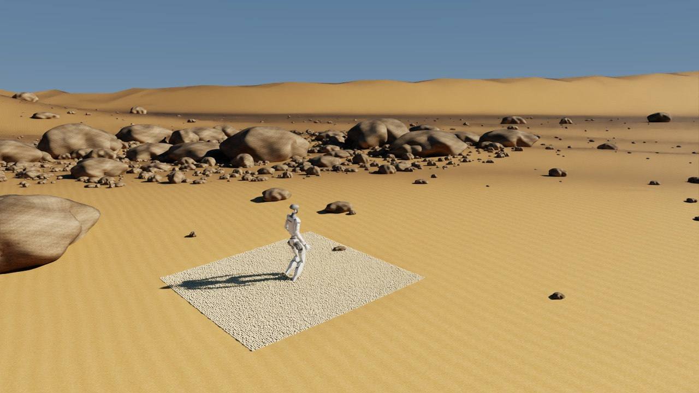
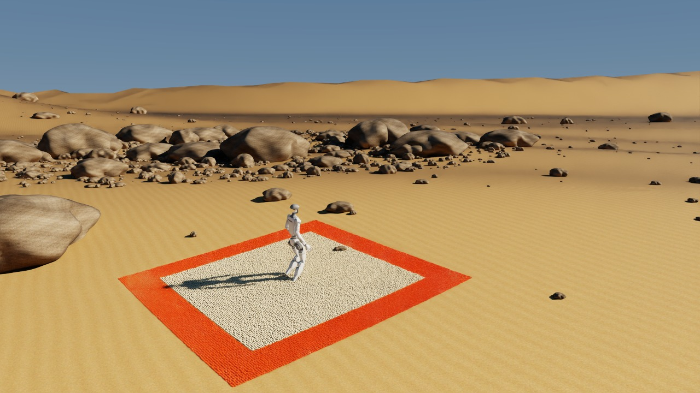

# Alpha MPM desert demo

This experimental demo runs the trained G1 policy with two-way MuJoCo/MPM
coupling, a moving alpha particle patch, a camera-centered terrain clipmap, and
a local bedrock collider with two resolutions. All example code is in this
directory. The original `desert_g1` rigid demo remains available.

```bash
uv run --no-sync -m newton.examples desert_g1_mpm --config config/g1.yaml
```

CUDA, PyTorch, MuJoCo, and the existing RTX dependencies are required. The policy
and robot asset use the same configuration and overrides as `desert_g1`.
I/K change forward velocity, J/L change sideways velocity, U/O change yaw, and
Backspace stops the command. The GUI camera tracking button switches between
following G1 and manual camera control. Moving the camera changes render coverage;
the physics patch continues to follow G1.



The default visible particle patch is **3 × 3 m**. Its surrounding boundary is
**0.5 m wide on each side**, giving a **4 × 4 m** total particle region. The older
demo displayed that entire 4 m square, which made the simulated region look larger.
The local alpha adaptation now uses a fixed, zero-mass boundary; the original
`mpm_moving_patch_alpha` examples have not been changed.

In the GUI side panel:

- **Deactivate camera tracking / Activate camera tracking** switches between
  manual camera control and following G1.
- **Show boundary terrain / Hide boundary terrain** displays or hides the orange
  boundary particles. This changes rendering only; the boundary always participates
  in MPM as kinematic supporting terrain.
- The panel prints the simulated width, boundary width, and total width in meters.

Boundary particles are hidden by default. Use `--show-boundary` to show them at
startup, or `--no-show-boundary` to hide them.



## Record a video

Video capture uses the same controls as MPM alpha and supports headless RTX:

```bash
uv run --no-sync -m newton.examples desert_g1_mpm \
  --headless --video walking.mp4 --video-duration 10 --video-speed 1
```

| Argument | Meaning |
| --- | --- |
| `--video walking.mp4` | Record rendered frames to an H.264 MP4; requires FFmpeg with libx264 on PATH |
| `--video-duration 10` | Record ten simulated seconds, then exit; overrides `--num-frames` |
| `--video-speed 1` | Normal playback; `2` plays twice as fast, `0.5` plays at half speed |

The MPM demo records 50 frames per simulated second. Ten simulated seconds
produce 500 frames: a ten-second video at normal speed or a five-second video
at twice normal speed. The encoded frame rate is `int(50 * video_speed)`, matching
alpha's integer frame-rate convention. Rendering may take longer than the video
duration. `--capture-frame` controls only a separate screenshot, not video length.

Omit `--headless` for windowed recording. Paused redraws do not add video frames;
closing the viewer early saves the frames already recorded. Keep the viewport
size fixed while recording. The recorder streams frames through FFmpeg using
one temporary PNG at a time, rather than accumulating video frames in RAM.
Capture and encoding add overhead and are included in recorded-run frame timings.
Audio is not recorded. The same arguments work with the original `desert_g1`
demo, which records 60 frames per simulated second.

## What is implemented

| Component | Behavior |
| --- | --- |
| Render clipmap | Eight nested square grids; 0.5 m finest spacing; 2,048 m outer width |
| Level transitions | Coarse inner edges split at fine-grid vertices; shared vertices avoid cracks |
| Camera movement | All levels share a center snapped to the finest grid; geometry refreshes when that center changes |
| Simulated terrain | 3 × 3 m with nonzero particle mass; initially 72,000 particles |
| Boundary terrain | 0.5 m on each side, zero mass and inverse mass, fixed in world space; initially 56,000 particles |
| Total particle region | 4 × 4 m; 128,000 particles with default settings |
| Adaptive collider | 8 m fine grid at 0.25 m spacing, surrounded by a coarser ring extending coverage to 16 m; 3,776 triangles total |
| Ground heights | Shared procedural dune function minus the 0.08 m sand depth |
| Physics timing | MPM at 100 Hz, six rigid substeps per MPM step (600 Hz), policy at 50 Hz |
| Rendering timing | One rendered frame per 0.02 s of simulated time; this is not a real-time performance claim |

The clipmap is a first implementation of nested geometry levels. It does not
implement independent per-level scrolling, incremental strip uploads, or geometric
morphing to hide LOD changes. The existing diagram's nested-grid principle applies,
but this implementation updates all levels together. The RTX mesh path currently
uploads positions/normals/topology each rendered frame and retains the initial
texture coordinates; texture movement and visible LOD changes still need refinement.

The collider adapts resolution spatially: fine triangles cover the full particle
bed and coarser triangles cover the surrounding area. It recenters with the
particle patch, resamples heights, refits its BVH, and updates rigid collision
bounds. It does not select triangles from the large rendered mesh or estimate
collision error to choose a resolution. Both physics solvers share its Warp mesh;
MPM registers it explicitly through `setup_collider`, avoiding a stale copy of
the initial rigid shape. Rocks remain visual-only.

The collider represents **bedrock beneath the sand**, not a second collider at
the sand top. G1 interacts with sand through the MPM body proxies and can contact
bedrock if it sinks through the shallow layer. The large terrain mesh never enters
either solver. The fine collider coverage must exceed the particle bed by at least
two MPM voxels; invalid configurations fail during setup.

## How the patch moves and renders

`alpha_patch.py` adapts the recycling rules from `mpm_moving_patch_alpha` without
importing its examples. The patch center snaps to a 0.5 m lattice around G1.
Particles remaining in the central 3 m square retain their dynamic state.
Boundary particles have zero mass and inverse mass and are pinned at their world
positions with zero velocity. As the patch moves, particles entering the central
square regain their physical mass; particles leaving it become kinematic.
Mass changes are copied into the coupled MPM entry and its derived density/masks
are refreshed before stepping. These transitions reset velocity so fixed terrain
does not introduce stale motion into the simulated region.
Particles leaving the full 4 m width wrap to the opposite side and
restore their original height above freshly sampled bedrock. Velocity, velocity
gradient, elastic strain, plastic volume ratio, stress, and render transform reset.
No departed terrain history is saved.

The renderer lowers the procedural surface to bedrock inside the visible patch
and blends back to the original sand height at its edge. With boundary visibility
enabled, this opening extends into the boundary region. It draws live
MPM particles in that opening. This exposes sand motion and prevents the unchanged
sand-top surface from filling footprints inside the patch. The edge is an
illustrative transition: there is no reconstructed continuous MPM surface yet,
and the buffer can show overlap between particles and the static surface.
Deformation disappears after the alpha patch leaves. Persisting footprints will
require a later beta/beta2-style terrain cache and a renderer that consumes it.

## Parameters and validation

Render coverage uses `--clipmap-cells`, `--clipmap-levels`, and `--clipmap-spacing`.
Collider resolution uses `--collider-spacing`. MPM uses `--mpm-size`,
`--mpm-buffer` (kinematic boundary width per side), `--sand-depth`, `--voxel-size`, `--particles-per-cell`,
`--patch-shift`, and `--mpm-iterations`. The inherited rigid-demo options
`--radius`, `--rings`, `--sectors`, `--collision-size`, and `--collision-spacing`
do not control this demo. CUDA graph capture is disabled while this integration
is being validated; `--use-cuda-graph` is rejected rather than silently ignored.

The defaults are intentionally a shallow sand test. An initial 0.25 m layer with
0.1 m voxels caused G1 to fall, including with alpha's existing sand material
parameters. The trained policy has not been validated on deep sand or arbitrary
dune slopes. The current material uses alpha's density of 3,000 kg/m³, Young's
modulus of 40 MPa, Poisson ratio of 0.3, and internal friction `tan(50 degrees)`.
G1/bedrock collider friction is 0.75.

```bash
uv run --no-sync -m unittest newton.examples.large_terrain_rendering.test_clipmap

uv run --no-sync -m newton.examples desert_g1_mpm \
  --viewer null --num-frames 250 --rocks 0 --test

uv run --no-sync -m newton.examples desert_g1_mpm \
  --headless --num-frames 300 --capture-frame 250 --test \
  --screenshot newton/examples/large_terrain_rendering/_generated/mpm/walking.png
```

Tests check stitched edges, bounded mesh storage, contact after a large collider
move, and complete recycling resets while retained particles keep their state.
The runtime check requires finite states and actual policy/MPM steps; runs of at
least one second also require an upright G1, and moving runs of at least five
seconds require travel and patch shifts. Particle positions must stay above
bedrock within two voxel widths. `timing.json` records frame timings, particle
count, patch/collider updates, recycled particles, and G1 motion.

The five-second null-viewer validation with a kinematic boundary traveled 3.93 m
with nine patch shifts and a final upright dot product of 0.996. Boundary masses,
inverse masses, and velocities were exactly zero, and positions matched their
fixed world positions. Measured median stepping time was about 98 ms per 20 ms
simulated frame on the RTX 5090, so this implementation is not real-time.
See [PERF.md](PERF.md) for measurements of the earlier dynamic-buffer version.

| File | Responsibility |
| --- | --- |
| `example_desert_g1_mpm.py` | Demo lifecycle, clipmap rendering, particle display, controls and capture |
| `clipmap.py` | Nested mesh topology, edge stitching and terrain sampling |
| `alpha_patch.py` | Particle allocation and alpha recycling |
| `mpm_simulation.py` | Adaptive bedrock collider and two-way G1/MPM coupling |
| `controller.py` | Shared G1 policy inference and joint targets |
| `test_clipmap.py` | Geometry, contact and recycling regression checks |
| `test_boundary.py` | Region dimensions, boundary mass transitions, fixed positions and GUI controls |

### Particle visibility

Use **Hide particles** / **Show particles** in the GUI to toggle all MPM particle
rendering. Particles are shown by default. Physics continues while particles are
hidden, and the background terrain mesh remains visible. Hidden particles skip
rendering compaction and position transfers. **Show boundary terrain** remains a
separate setting; showing particles again restores that setting.
