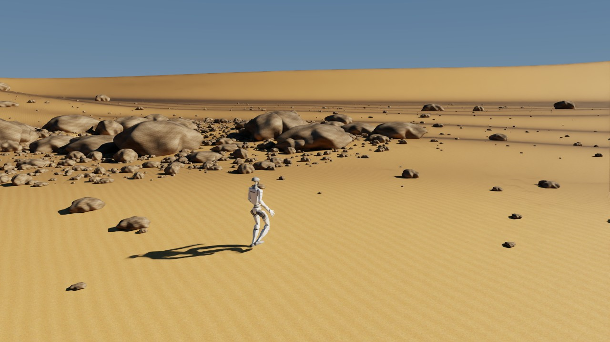
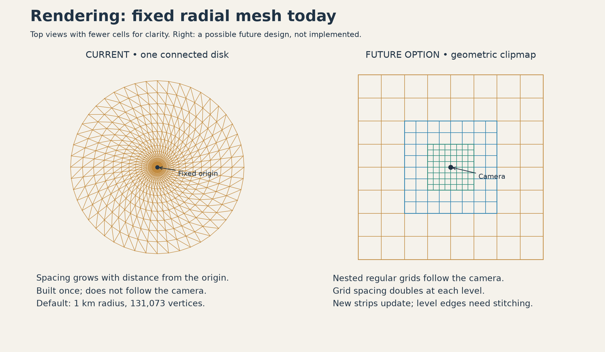
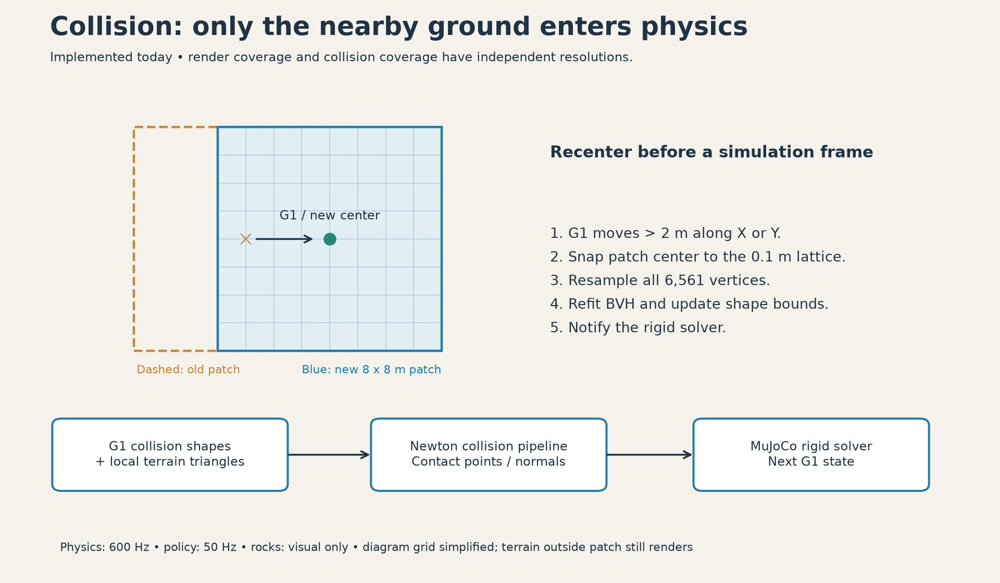
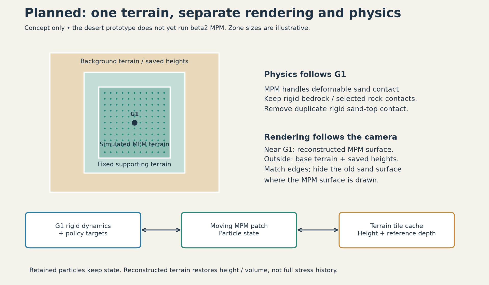

# Desert rendering prototype

**Video capture:** both demos support headless RTX recording with
`--video walking.mp4 --video-duration 10 --video-speed 1 --headless`.
Recording duration is in simulated seconds and overrides `--num-frames`.
See [video controls](MPM_DEMO.md#record-a-video) for playback speed and requirements.

**New: [alpha MPM + clipmap demo](MPM_DEMO.md).** Run
`uv run --no-sync -m newton.examples desert_g1_mpm --config config/g1.yaml`
for coupled G1/sand physics, nested terrain grids, and a local collider with
adaptive resolution. The documentation below describes the original `desert_g1`
rigid demo; its fixed radial render mesh remains unchanged. The alpha demo and
the planned beta2 integration are separate stages.

A standalone Python/Warp scene with procedural sand dunes, a rocky basin,
instanced stones, and a Unitree G1 driven by a trained locomotion policy. The visual reference is
[MAWI's Dune Desert — Stone Pit](https://www.youtube.com/watch?v=tXw5O9HtP84).



Run in the existing configured environment from the Newton repository root:

```bash
uv run --no-sync -m newton.examples.large_terrain_rendering.example_desert_g1 --config config/g1.yaml
```

Policy mode is the default. It requires PyTorch, MuJoCo, the examples/RTX
dependencies, and the trained TorchScript model referenced by `config/g1.yaml`.
The policy/config and robot asset are external data; all controller and simulation
code is local to this directory. `--policy /path/to/policy.pt` and
`--robot-asset /path/to/g1.xml` override the configured weights and MJCF/URDF.
The loader checks a sibling `newton-assets/unitree_g1` checkout before Newton's
asset cache. The configured improved-foot model must be present there, or supplied
explicitly; it is not assumed to exist in every published G1 asset revision.

The default command is 0.6 m/s forward, applied after 0.5 s settling. I/K change
forward speed, J/L change sideways speed, U/O change yaw rate, and Backspace stops
the command. Releasing a key retains the command. Use `--command 0 0 0` to start
standing. The default camera follows the robot; use `--camera fixed` or `orbit`
for the earlier camera modes. Viewer mouse/keyboard navigation remains available
with the fixed camera. In the GUI side panel, click **Deactivate camera tracking**
to keep the current view and navigate manually. Click **Activate camera tracking**
to follow G1 again; this also works while paused. The button is available in policy mode.

Capture an actual walking frame and run the upright/contact checks:

```bash
uv run --no-sync -m newton.examples.large_terrain_rendering.example_desert_g1 \
  --headless --num-frames 600 --capture-frame 500 --test \
  --screenshot newton/examples/large_terrain_rendering/_generated/walking.png
```

For the original rendering-only mode:

```bash
uv run --extra examples --extra rtx -m newton.examples.large_terrain_rendering.example_desert_g1 \
  --g1-mode posed --camera fixed
```

`--no-g1` shows only terrain. `--g1-asset /path/to/model.usda` overrides the visual
USD in posed mode. `--width` and `--height` set RTX resolution. `--radius`,
`--rings`, and `--sectors` control render geometry; `--rocks 0` hides all stones.

## How rendering works today

The prototype renders a large, static landscape through `ViewerRTX`. It builds
the landscape once as a USD scene (Universal Scene Description), adds it as the
viewer background, and sends the simulated G1 pose to the viewer each frame.
Rendering and physics use separate terrain meshes. A mountain can be visible
without being part of the rigid contact calculation.



**The current mesh is not a geometric clipmap.** It is one connected disk,
centered at world XY `(0, 0)`, with a fixed number of angular sectors and radial
rings. In [terrain.py](terrain.py), ring `i` has radius
`r_i = radius * (i / rings)^2`. This puts more vertices near the origin and fewer
per square meter far away. With the defaults (`--radius 1000 --rings 256
--sectors 512`), it has **131,073 vertices and 261,632 triangles**, covering a
2 km diameter. Both radial spacing and arc length between adjacent sectors grow
toward the edge.

Level of detail (LOD) means allocating less geometric detail where it contributes
less to the image. This mesh has a fixed distribution of detail by distance from
the origin; the example does not select LOD levels based on the current camera,
recenter the render mesh, or stream new terrain as the camera moves. Following
G1 only changes the camera pose. After a long walk, G1 can reach coarse render
triangles even though the collision patch stays fine. The full disk remains in
the rendering scene; the example does not implement terrain tile selection or
terrain-specific visibility culling.

A **geometric clipmap** would use nested regular grids centered near the camera,
with spacing doubling between levels. As the camera moves, the grids shift on
their sampling lattices and newly exposed strips are updated. Transitions between
levels need stitching and/or blending to prevent cracks and visible jumps. This
is a possible next rendering design, not implemented behavior; the right side
of the illustration omits those transition details. See the primary description
in [GPU Gems 2: Terrain Rendering Using GPU-Based Geometry Clipmaps](https://developer.nvidia.com/gpugems/gpugems2/part-i-geometric-complexity/chapter-2-terrain-rendering-using-gpu-based-geometry).

The current image is assembled from the following parts:

| Part | Implementation | What it contributes |
| --- | --- | --- |
| Dune geometry | Warp evaluates the dune profile plus visual height noise; normals follow the resulting surface | Dune silhouettes and irregular surface shape |
| Sand and rock materials | Procedural 1024 × 1024 color and normal textures, authored through USD materials | Grain and ripple shading; normal maps do not displace geometry or create contacts |
| Stones | A USD `PointInstancer` places 4,500 instances of six rock meshes by default | Reuses prototype geometry with different positions, scales, and rotations; no rock LOD selection yet |
| Lighting | A textured dome light and a directional sun | Sky illumination and directional shadows; the sky gradient is not atmospheric scattering |
| Moving G1 | `viewer.log_state()` receives the current rigid body state | The policy-driven robot moves within the static landscape |

The terrain, textures, and rock placement are authored at startup in
`--output-dir`; the application does not rebuild or upload the background terrain
vertices each frame. RTX still has to render the visible scene each frame.
Instancing and coarse distant triangles reduce different costs: instancing reuses
rock geometry, while the radial mesh limits terrain vertex count. Neither makes
the whole landscape a physics collider.

## How local rigid contact works today



The rendered terrain has a 1000 m radius. Physics uses one moving 8 by 8 m mesh
with 0.1 m spacing: 6561 vertices and 12,800 triangles. It samples the same
procedural dune height function, but its resolution is independent of the
render mesh. `--collision-size` and `--collision-spacing` control this budget.

When G1 moves more than a quarter of the patch width from its center, the patch
recenters on the world sampling lattice. Existing samples retain their heights.
The code refits the mesh BVH, updates the collision bounds and transform, and
notifies the solver. Mesh storage and topology stay fixed. The complete render
mesh never enters the physics model.

Newton's collision pipeline computes triangle contacts; `SolverMuJoCo` advances
the rigid robot at 600 Hz using those contacts. The controller evaluates the
actual policy at 50 Hz with the reference example's observation ordering,
history initialization, scales, joint gains, and heading command convention.
CUDA devices capture pairs of physics steps while policy inference and patch
updates run outside the graph. `--no-use-cuda-graph` selects ordinary stepping.
CPU physics is uncaptured.

This first collision selection covers the dune surface. Rocks and gravel are
visual-only; their colliders are not yet selected into the patch. The robot has
no deformable sand interaction. The local contact mesh approximates the rendered
surface, so differences can grow where the render mesh is very coarse.

The collision patch is a **spatial selection of nearby terrain at one uniform
resolution**, rather than a hierarchy of collision LOD meshes. It samples the
height function directly; it does not cut triangles from the render disk. The
recenter test uses the largest X/Y offset, so the default trigger is movement
greater than 2 m along either axis. The new center snaps to the 0.1 m world
lattice, and the implementation resamples the entire patch, not just entering
strips. This keeps its triangle count bounded as G1 travels.

A BVH (bounding volume hierarchy) groups mesh triangles into nested bounds so
contact queries can narrow down nearby triangles. When the patch moves,
`TerrainCollisionPatch.update()` refits that hierarchy to the new vertex positions
and updates the shape's bounds and transform. Newton's collision pipeline then
generates contacts between the robot collision shapes and the local terrain;
MuJoCo resolves them together with joint dynamics and policy targets.

For each 1/60 s example frame, [simulation.py](simulation.py) checks patch coverage
before advancing ten 1/600 s physics substeps. Contacts are recomputed every
substep. Policy targets update every twelve physics substeps (50 Hz), independent
of the ten-substep frame grouping. The resulting robot state is then rendered.
The 60 Hz simulation clock does not imply a measured 60 rendered frames/s; see
[PERF.md](PERF.md) for measured wall time.

Only one tracked robot's nearby terrain is covered. There is no terrain contact
outside this patch. Larger bodies, fast motion, or additional robots will need
coverage based on all relevant collision shapes and their expected travel, with
enough margin before a recenter. The current check is suitable for the short G1
walking prototype; it is not a general swept-motion coverage guarantee.

## Planned integration with moving patch MPM beta2

**This section describes planned work. The desert example currently runs rigid
contact only and imports no beta2 MPM code.** MPM (Material Point Method) represents
sand with particles and advances its material dynamics using a simulation grid.
We will keep the large landscape renderer separate from that local simulation.
Rendering coverage will follow the camera; simulated terrain coverage will follow
G1. Disabling camera tracking must not move or disable the physics patch.



The beta2 [moving terrain implementation](../mpm_moving_patch_beta2/impl/moving_terrain_mpm.py)
already provides a bounded moving region of simulated particles and a surrounding
band of fixed supporting terrain. Its
[terrain height cache](../mpm_moving_patch_beta2/impl/terrain_height_cache.py) keeps a
fixed-size GPU window of nearby height and reference-depth samples. Reference
depth records the material volume per terrain column used for reconstruction.
Changed tiles are saved as CPU arrays when that window moves; untouched terrain
can be regenerated. GPU terrain storage stays bounded, but CPU storage grows
with changed terrain, so long runs will eventually need an eviction or disk policy.

Particles that remain in simulated terrain retain their state. Terrain
reconstructed from saved tiles restores height and volume, **not full particle
velocity or material stress history**. This distinction matters when revisiting
footprints: preserving the surface shape is different from resuming the exact
previous sand motion.

We will connect the systems in the following order:

1. **Define shared terrain samples.** We will use common world XY coordinates,
   meters, seed, tile indices, and sampling rules. The current `dune_height`
   represents the sand top surface. Beta2 distinguishes the solid ground from
   sand above it, so we will explicitly define ground height and sand depth before
   generating particles. We will adapt the terrain sampler rather than assume
   beta2's existing terrain generator produces these dunes. Beta2 currently uses
   a moving planar support slab; a curved dune ground surface will also require
   matching local support geometry, not just a different particle height sampler.
   Render vertices,
   collision geometry, and initial particles must agree at shared sample points.
2. **Replace local rigid sand contact with coupled MPM contact.** We will retain
   `controller.py` for policy observations and joint targets and connect rigid G1
   dynamics to local MPM through the two-way coupling pattern in beta2's
   [box example](../mpm_moving_patch_beta2/example_moving_terrain_mpm_box.py).
   That example uses `SolverCoupledProxy` with MuJoCo and implicit MPM entries;
   it is an integration reference, not evidence that G1 has been validated on
   deformable dunes. We will remove the rigid sand-top collider where MPM handles
   sand contact, while keeping required solid ground and selected rock contacts.
   Otherwise the feet would receive duplicate support and could not sink properly.
3. **Render the changing sand surface.** We will first show particles for debugging,
   then reconstruct a local surface for RTX. Outside simulated terrain, rendering
   will sample saved surface heights where available and procedural heights
   elsewhere. We will hide or replace the old sand surface under the local surface,
   match its boundary samples, and blend normals/materials across the transition.
   Simply drawing particles over the existing disk would leave the undeformed
   surface visible through excavated footprints. A local surface reconstruction
   and dynamic RTX geometry updates still need to be implemented and measured.
4. **Add camera-driven render LOD independently.** We will prototype a geometric
   clipmap or tiled mesh using the same terrain samples. We will update geometry
   when camera coverage changes or MPM changes surface tiles. Render LOD boundaries
   need not match the MPM boundary. Deformations must remain visible after the
   physics patch leaves, and coarse render levels must receive updated heights.

We will validate these steps on a small scene before increasing the visible
radius: stable G1 contact and sand reaction forces, no duplicate sand contact,
continuous surfaces during patch movement, preserved footprint height/volume
after leaving and revisiting, and bounded GPU particle/grid/mesh storage. We will
measure policy, rigid physics, MPM, terrain updates, and RTX time separately.
The rigid prototype's timestep, CUDA capture, and short-route policy validation
do not establish stable or real-time performance for the coupled simulation.

## Files and validation

All implementation and example-specific documentation live here. The three PNG
illustrations and their source are in `docs/`. Regenerate them with Matplotlib
installed in the environment:

```bash
uv run --no-sync python newton/examples/large_terrain_rendering/docs/generate_diagrams.py
```

| File | Responsibility |
| --- | --- |
| `example_desert_g1.py` | Example lifecycle, camera, capture, timing, and command-line options |
| `controller.py` | G1 model setup, observation history, TorchScript inference, and keyboard commands |
| `simulation.py` | Rigid solver, policy/physics timing, and locomotion validation |
| `collision.py` | Bounded terrain collision mesh and recentering |
| `terrain.py` | Warp height function, connected terrain mesh, and procedural rock geometry |
| `scene.py` | Static USD scene, instanced rocks, procedural materials, native G1 reference, sky, and sunlight |
| `test_terrain.py`, `test_collision.py`, `test_controller.py` | Rendering geometry, moving contacts, and policy observation tests |
| `terrain_rendering_plan.md` | Visual references and longer-term milestones |

Generated USD, textures, and `timing.json` are written to `_generated/` (ignored
by Git), or to `--output-dir`. Use a separate output directory for concurrent
runs. Render terrain and rocks are generated once; their vertices are not uploaded
each frame. The collision patch updates only when it recenters. The terrain is a connected circular mesh whose spacing increases toward
the horizon. It does not yet stream or recenter as the camera moves.

Timing reports measure CPU wall time around synchronous RTX rendering after
`--warmup-frames` (default 32). They include renderer work and synchronization;
they are not GPU timestamp measurements or a guarantee of sustained frame rate.
The screenshot is saved at `--capture-frame` (default 32), outside the timed
render section. Cold shader compilation and scene creation happen before the
steady-state samples. `first_render_seconds` includes the initial RTX setup and
shader work. ViewerRTX requests frame generation by default; this report does
not count generated frames separately. Use a longer run to assess consistent
performance. See [PERF.md](PERF.md) for the measured prototype configuration.

Validation:

```bash
uv run --no-sync -m unittest newton.examples.large_terrain_rendering.test_terrain \
  newton.examples.large_terrain_rendering.test_collision newton.examples.large_terrain_rendering.test_controller
uv run --no-sync -m newton.examples.large_terrain_rendering.example_desert_g1 \
  --viewer null --num-frames 600 --test
```

The null viewer runs the same policy and physics without RTX. With `--test`,
runs of at least one simulated second require actual contacts and an upright
robot. Runs of at least three seconds with a nonzero translation command also
require measurable travel. JSON reports include inference counts, displacement,
contact counts, patch updates, physics step time, and combined step/render time.

Current limitations: fixed render terrain coverage; approximate terrain normals
at coarse resolutions; procedural materials without authored scans; no rock
contacts, atmospheric scattering, vegetation, or terrain deformation. The policy
has been validated on a short, gently varying route, not arbitrary dune slopes. The
sky is a generated environment gradient, not a physical atmosphere model.

Assets: sand/rock geometry, textures, and sky are generated by this example.
G1 geometry comes from the `unitree_g1` asset package. Posed mode references its
USD materials directly; policy mode imports the configured MJCF/URDF model. The package uses the BSD 3-Clause license,
copyright Unitree Robotics; its original license remains alongside the cached
asset. The MAWI video is an appearance reference;
no MAWI content is packaged with the prototype.

### Visual mesh roughness

Both desert examples add seeded Perlin noise to the visual mesh in world coordinates.
`dune_visual_noise()` in `terrain.py` combines feature spacings of 24, 8, and 2 m,
with height multipliers of 0.6, 0.25, and 0.1 m. Adjust these constants to change
roughness. The existing `--seed` selects the noise pattern. Vertex normals follow
the displaced mesh, and mesh vertex counts stay the same.

This noise is visual only: `dune_height()` still supplies the original collision
and particle heights. The radial mesh fades noise in from 5 to 15 m around the
origin. The MPM clipmap fades noise in over 5 m outside its particle opening, so
particles meet the original surface at the opening. The collision clipmap leaves
`visual_noise=False`. Distant mesh detail remains limited by vertex spacing.
