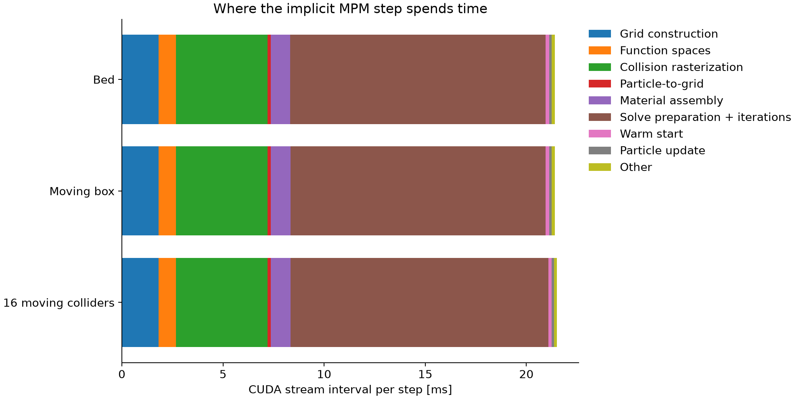
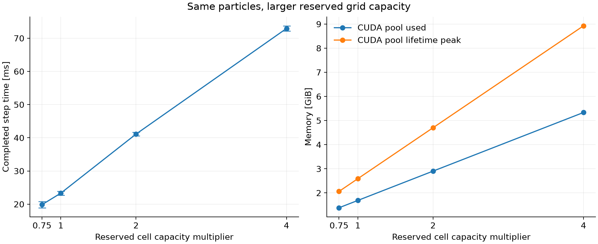
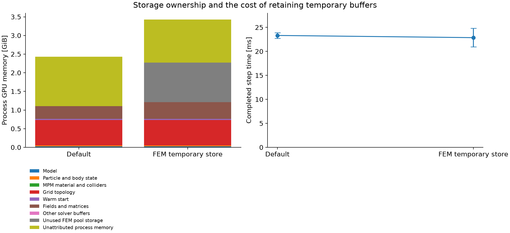

# Implicit MPM component profile

This directory preserves historical profiling results. The experimental
`newton/_src/solvers/implicit_mpm_improve` directory was removed when preparing
this branch; commands below that use it document the original runs and cannot
be rerun from this branch alone.

## Findings

The first optimization target is **work and storage sized by reserved grid capacity**,
followed by **material/contact solve preparation and iterations**. Particle advection
is a small part of these workloads. This report measures the current local reference
solver; it does not claim a new numerical algorithm or a production-ready optimization.

For the moving box, reducing reserved cells from 131,072 to 98,304 reduced completed
step time from **23.32 to 19.86 ms** (about **15% less time**) and CUDA-pool used memory
from **1.689 to 1.385 GiB** (about **18% less memory**). Particle positions and velocities
at the end of the timed interval had identical hashes. This is a configuration result,
not an unbounded-scene solution: smaller capacity still needs to accommodate particle
motion and grid construction. A 65,536-cell attempt overflowed during initialization.

The reference solver files were not modified by this investigation. Instrumentation
and profiling scripts are isolated in `newton/_src/solvers/implicit_mpm_improve`.
`ProfiledImplicitMPM` calls the reference implementation; it adds timing scopes only.
Any subsequent numerical implementation will be placed in that experimental directory.

## Setup and measurement

Measurements were recorded on an NVIDIA GeForce RTX 5090, Warp 1.17.0 and Python 3.12.
Each case used three fresh-process baseline runs and three separate diagnostic runs,
interleaved by repetition. Each run warmed up for 120 physics steps, then measured
120 complete steps. The table reports mean ± population standard deviation across
360 baseline steps per case. Per-run means and individual samples are retained.

The initial bed is 2 × 2 × 0.24 m with **120,000 particles**. Grid spacing is 0.025 m;
particle spacing is 0.02 m (1.25 samples per voxel dimension), radius 0.01 m, and
jitter distance 0.001 m. Density is 2,500 kg/m³, Young's modulus 10 MPa, Poisson ratio
0.3, particle friction 0.75, and yield pressure 10¹² Pa. Every comparison uses these
same material and sampling parameters. Time step is 1/240 s.

The solver uses rebuildable sparse storage, APIC transfer, PIC integration, Q1 velocity,
P0 strain, S2 collider basis, `solver="auto"`, `warmstart_mode="auto"`, tolerance 10⁻⁴,
and a maximum of 100 iterations. The outer loop is eager Python; the reference solver
still uses its internal conditional CUDA graph for iterations. No rendering, policy,
video capture, moving-patch recycling, or coupled rigid-body solver is included.
The bed is warmed and settling, not certified to be fully settled or converged.

The box follows a prescribed sinusoidal X path. The collider-heavy case uses 16 small
prescribed boxes, not a robot asset. These controlled cases isolate MPM work; they do
not establish G1, IsaacLab, moving-patch-transition, or many-environment performance.
A static floor is present in every scene. The default reserved cell count is 131,072.
The capacity sweep changes `max_active_cell_count`; NanoVDB node capacities remain
automatic, so their derived reservations also change. All other settings stay fixed.

No competing CUDA compute process was detected at case start or measurement end.
Desktop graphics applications remained active. This is not continuous GPU exclusivity
monitoring. The temporary-store case has a larger timing spread; its small mean gain
should not be treated as a reliable performance improvement without longer repeats.

| Case | Baseline step [ms], mean ± std | Instrumented step mean [ms] | CUDA pool used [GiB] |
| --- | ---: | ---: | ---: |
| Bed + floor | 23.28 ± 0.61 | 23.40 | 1.689 |
| Moving box | 23.32 ± 0.59 | 23.42 | 1.689 |
| 16 moving colliders | 23.66 ± 0.64 | 23.53 | 1.689 |
| Box, 98,304 cells | 19.86 ± 0.93 | 19.81 | 1.385 |
| Box, 262,144 cells | 41.12 ± 0.54 | 41.21 | 2.904 |
| Box, 524,288 cells | 72.94 ± 0.80 | 72.94 | 5.334 |
| Box, retained FEM temporary store | 22.86 ± 1.94 | 22.53 | 2.714 |

Baseline runs instantiate the original solver class. Diagnostic runs use nested CUDA
events without synchronizing between stages; both modes synchronize once after each
complete step. Diagnostic event creation/recording and Python wrappers add overhead;
the table makes that visible. Initialization and JIT warmup are outside the timed
interval, but per-step graph capture and destruction remain inside it.

## Where time is spent



The following breakdown is for the moving box. Percentages use the sum of recorded
solver-stage intervals, not the complete host step. These intervals total about
21.4 ms; the completed step is about 23.3 ms, including surrounding dispatch and
synchronization. Nested scopes are subtracted from their parents to avoid double counting.

| Component | CUDA stream interval [ms] | Share of recorded stages |
| --- | ---: | ---: |
| Grid construction | 1.810 | 8.5% |
| Function spaces | 0.860 | 4.0% |
| Collision rasterization | 4.532 | 21.2% |
| Particle-to-grid | 0.168 | 0.8% |
| Material assembly | 0.975 | 4.6% |
| Solve preparation + iterations | 12.615 | 58.9% |
| Warm start | 0.172 | 0.8% |
| Particle update | 0.108 | 0.5% |
| Other | 0.171 | 0.8% |

**CUDA stream interval is not pure kernel execution time.** It can include time when
the GPU waits for CPU submission. CPU submission, GPU work, and a later CPU wait may
overlap. Their timings must not be added as independent costs.

A separate Warp activity trace records the iteration graph at about **8.76 ms per
step**, compared with the broader solve-preparation/iteration interval of 12.61 ms.
The trace records a whole graph launch; it does not separate the contact and material
kernels inside that graph. It also shows `collision_weight_field` at about 0.65 ms,
`compliance_form` at 0.36 ms, and the collider rasterization kernel itself at 0.09 ms
per step in the moving-box diagnostic. These are separate three-step diagnostics,
not kernel timings collected during the 360-step baseline interval.

Consequently, the 4.53 ms rasterization stage must not be interpreted as 4.53 ms of
shape-distance queries. It includes field interpolation and sparse contact mappings.
The bed, one-box, and 16-box results are close, so these simple collider cases provide
little evidence that pruning primitive shape queries should be the first change.
Triangle meshes or a full robot could give a different result.

The CPU profile puts about **0.58 ms per step** in `_run_solver_loop`, which includes
conditional graph construction and launch. It also attributes substantial time to
Warp graph destruction. That destruction can wait for outstanding GPU work; it is
not proof that graph reuse would remove all of that time. Likewise, particle update
occupies only about **0.11 ms** here. Optimizing particle writes alone cannot explain
or eliminate a roughly 23 ms complete step in this workload.

## Why reserved capacity matters



The moving-box cases end with **63,074 active voxels**, whether cell capacity is
98,304, 131,072, 262,144, or 524,288. An active voxel is a cell present in the current
sparse grid; reserved capacity is storage available for current and future cells.
`cell_count()` and `Volume.get_voxel_count()` in this rebuildable path return the
reserved length. The profiler uses `get_active_stats().voxel_count` for the active count.
The final active count does not prove the same capacity is sufficient at initialization
or at every intervening step; the 65,536-cell failure demonstrates this distinction.

At 131,072 reserved cells, the Q1 velocity-node buffer holds **1,048,576 entries**.
The current function-space construction reserves up to eight velocity nodes per cell,
rather than allocating only the shared nodes present in a compact bed. The S2 collider
space also reserves its per-cell maximum. This is visible directly in
`ImplicitMPMScratchpad._create_velocity_function_space()` and
`_create_collider_function_space()` in the reference solver.

Larger reservations therefore increase more than the NanoVDB cell table: topology,
partitions, grid fields, sparse matrices, reductions, and some launches also grow.
Doubling reserved cells costs 41.12 ms per step; quadrupling costs 72.94 ms, despite
unchanged particles and final active-cell count. End-of-interval position/velocity
hashes are identical across these moving-box capacity cases.

The first structural change will separate **allocated capacity** from **current
work count**. It will retain safe allocation headroom and overflow detection while
making eligible scans, field updates, matrix operations, and reductions process only
valid entries. A second part will bound velocity/collider storage using a valid shared-node
capacity instead of the most conservative per-cell product. Changing loop lengths alone
will not reduce reserved VRAM; changing buffer capacities alone will not eliminate all
work on unused entries. Both need measurement and correctness checks.

## Where memory is stored



The buffer inventory below is from the last baseline moving-box run after synchronization.
It removes overlapping array views. Shared bytes are attributed to the first owning
group in this order: model, physical state, material/collider data, grid topology,
warm starts, fields/matrices, other solver buffers, and remaining FEM pool storage.
The inventory covers reachable Warp arrays and NanoVDB buffers, not every driver allocation.

| Storage group | Unique buffer storage [MiB] |
| --- | ---: |
| Model | 27.93 |
| Particle and body state | 21.06 |
| MPM material and colliders | 2.29 |
| Grid topology | 696.02 |
| Warm start | 33.00 |
| Fields and matrices | 348.50 |
| Other solver buffers | 0.46 |

The largest inventoried group is **grid topology**, about 696 MiB. Fields/matrices
use another 349 MiB, versus about 21 MiB for physical particle/body state. Grid topology
includes NanoVDB cell/node buffers and connectivity/lookup arrays, not just a small
list of active coordinates. Examples include a roughly 245 MiB node-volume buffer,
a 31 MiB cell-volume buffer, and capacity-sized candidate/index arrays. Several
collider vector fields each require roughly 30 MiB at this capacity.

Memory measurements have different meanings:

- **Process GPU memory:** NVIDIA-SMI snapshot after the measured interval; includes
  the CUDA context, loaded modules, graphs, allocator retention, and array storage.
  It was about 2.43 GiB for the final baseline box run. The plotted remainder is
  explicitly unattributed process memory, not additional particle state.
- **CUDA pool used:** CUDA's current used-memory counter, 1.689 GiB for that run.
  This is a different measure from process VRAM and includes allocations not reached
  by the Python buffer inventory.
- **CUDA pool lifetime high:** the high-water counter since process start, 2.590 GiB
  for that run. It includes initialization and warmup. It is **not** a sampled
  steady-state peak or total peak process VRAM.

These categories must not be added together. The tool does not yet assign every
transient allocation to the exact phase that reaches the lifetime peak.

The existing `temporary_store=fem.TemporaryStore()` option reduces the measured mean
from 23.32 to 22.86 ms, only about 2%, with substantial run-to-run spread. CUDA-pool used
memory rises from 1.689 to 2.714 GiB. Saved physical state is exactly equal for this
comparison. Broadly retaining temporary buffers is therefore not the first improvement
for this workload; targeted reuse needs to justify both time savings and retained bytes.

## Correctness and convergence limitations

All measured cases passed finite-value checks for positions, velocities, APIC velocity
gradients, elastic strain, plastic volume ratio, stress, and rendering deformation.
The sparse rebuild status remained clear for successful cases. The smaller 65,536-cell
attempt failed at initialization and is excluded from all plotted timings.

The saved baseline box state was compared with the diagnostic run and both runs using
the temporary store. All seven saved attributes were **bitwise identical**. Details are
in [state_comparison.json](state_comparison.json). This validates these tested paths;
it does not establish long-duration stability or prove a future optimization correct.

Separate post-timing verbose diagnostics repeatedly printed termination at counter
101 with the configured 100-iteration limit (the internal counter starts at one and
advances in groups of five). Some residual norms exceeded tolerance, and some default
allocation runs printed **NaN or infinity residual norms even though the saved physical
state was finite**. The exact cause was not established. Temporary-store diagnostic
runs printed finite norms in the sampled checks, but this is not proof of a fix.

These are capped-iteration workloads, not a converged-simulation benchmark. The residual
reduction/reporting and stopping-condition path needs investigation before changing warm
starts, iteration skipping, or convergence criteria. No iteration count or tolerance was
reduced to obtain the performance comparison.

## Implementation order supported by these results

1. **Reserved capacity and valid-entry work (candidate 8).** Instrument each large
   topology/field/matrix buffer and loop length, then implement safe compaction or
   device-side valid counts. Retain overflow handling and multi-world isolation.
2. **Material/contact solve (candidates 9 and 12).** First resolve residual validity.
   Then profile inside the iteration graph, comparing cost per iteration and iterations
   to the same trustworthy stopping condition. Nsight Systems/Compute were not available
   on this machine, so occupancy and individual kernels inside the graph are not measured.
3. **Collider field/matrix setup (candidates 6, 7 and 10).** Separate field construction,
   sparse mapping assembly, and actual distance queries before choosing caching or pruning.
4. **Targeted reuse (candidates 2 and 5).** Measure one retained object at a time.
   Avoid treating GPU waits in graph destruction as CPU work that can simply disappear.
5. **Particle transfer/update specialization (candidates 3 and 4).** Revisit for much
   larger particle counts per cell; those stages are small in the current configuration.

Candidate 1, moving-patch property refresh, is outside these core-solver measurements.
Full G1 geometry, two-way rigid coupling, patch transitions and many independent worlds
are the next validation workloads, not results established by the 16-box surrogate.

## Reproduce and inspect

Run from the Newton repository. No viewer is started.

```bash
uv run --no-sync python -m newton._src.solvers.implicit_mpm_improve.run_profiles
uv run --no-sync python -m newton._src.solvers.implicit_mpm_improve.plot_profiles
```

For one case or custom capacity:

```bash
uv run --no-sync python -m newton._src.solvers.implicit_mpm_improve.run_profiles --case box
uv run --no-sync python -m newton._src.solvers.implicit_mpm_improve.profile \
  --scene box --capacity 98304 --diagnostic --output /tmp/mpm_profile.json
```

The first command reruns the seven cases with fresh processes and interleaved baseline/
diagnostic modes. Numerical solver settings are unchanged across measurement modes.
The 65,536-cell overflow can be reproduced by setting `--capacity 65536` in the second
command; that intentionally failing case is not part of the normal suite.

- [summary.csv](summary.csv): main comparisons.
- [summary.json](summary.json): stage, memory and repeat summaries.
- `results/*.json`: full step samples, CPU call profiles, GPU activity summaries,
  convergence logs, configuration, hardware and reference-source SHA-256 hashes.
- `results/*.log`: subprocess output, including the excluded overflow attempt.
- `results/*.npz`: selected final physical-state snapshots for equivalence checks.

The source hashes include the pre-existing local solver edits. Results describe this
checkout, not an assumed upstream release. Baseline solver source files were unchanged
throughout the measurement suite.
