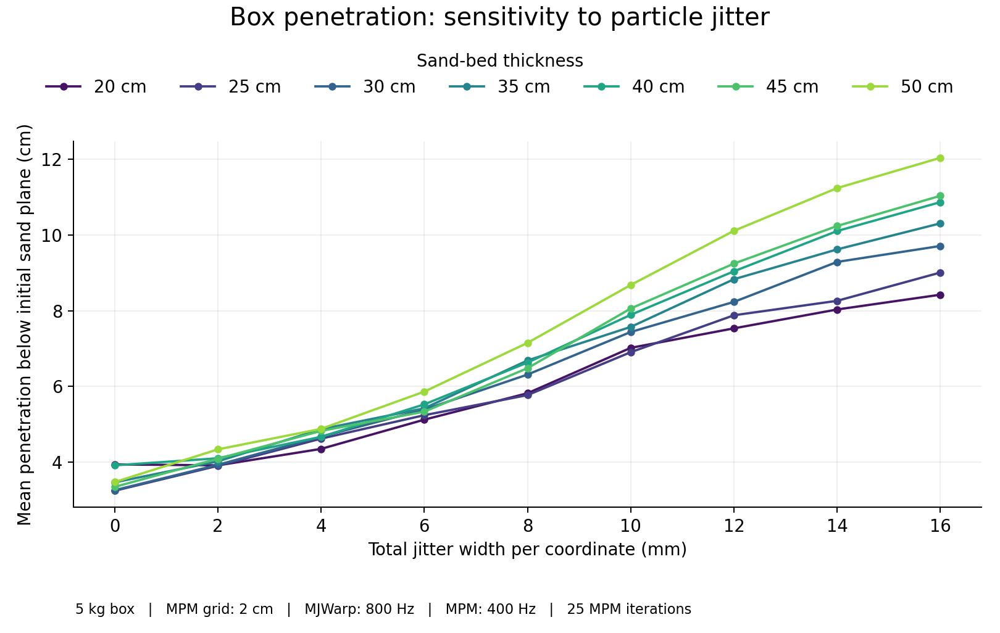
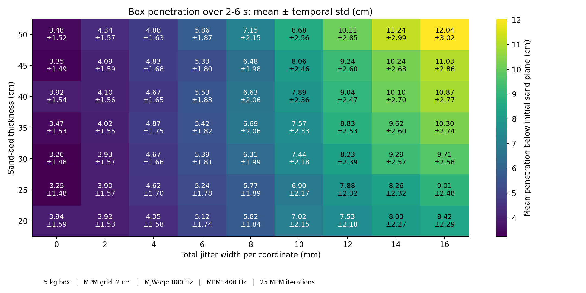
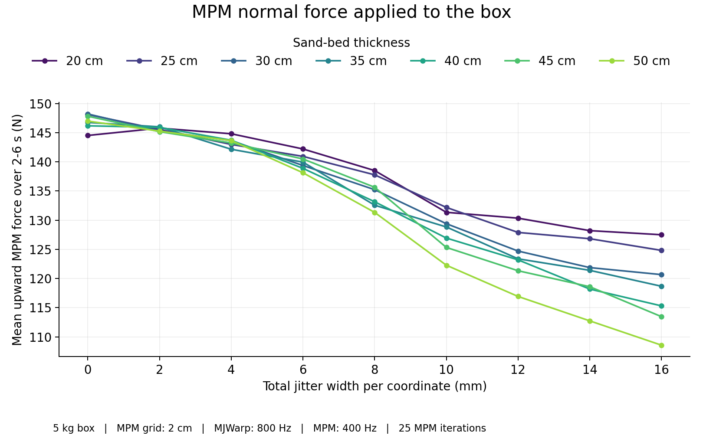
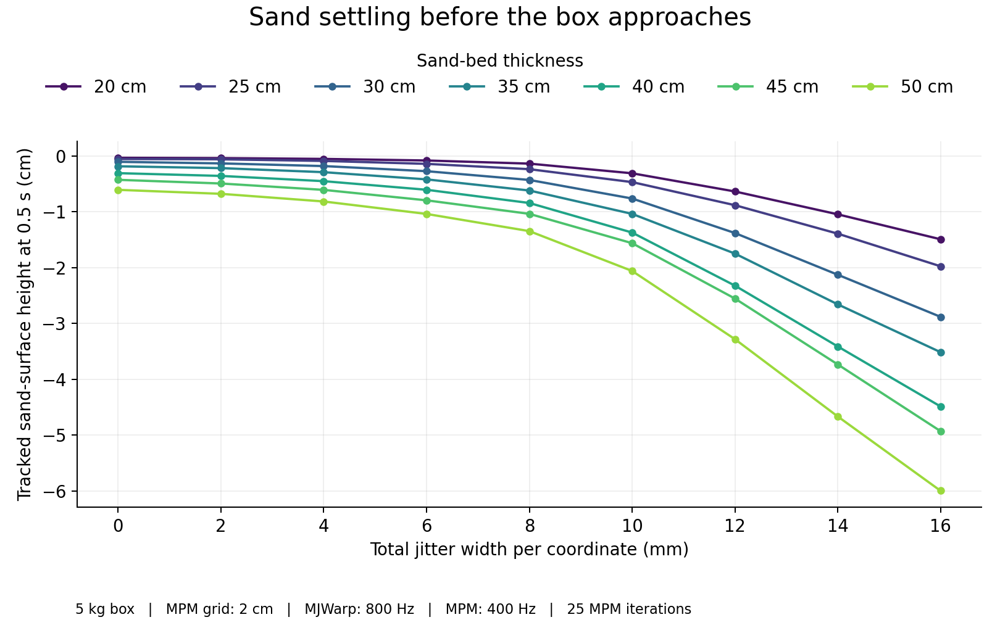
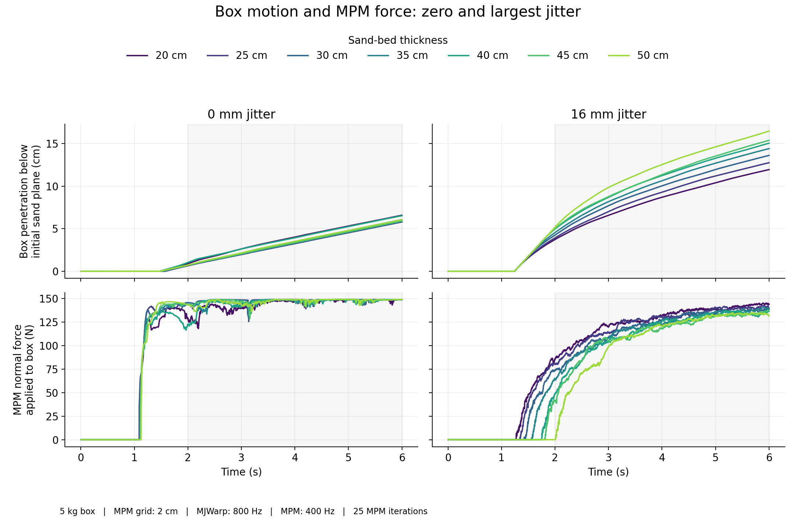

# Standalone Newton: box penetration versus particle jitter and sand depth

## Problem

Does the jitter-dependent sand-depth sensitivity seen with G1 persist without the moving-patch algorithm?

## Possible explanation

1. Initial particle disorder changes sand settling or its support of the box.
2. Moving-patch recycling or its boundary-particle handling introduces the sensitivity.
3. The shared MPM solver or rigid–MPM coupling responds differently as sand depth changes.

## Verification

- Used **standalone Newton**, with **no Isaac Lab imports** or moving-patch code.
- Kept all sand particles dynamic inside a **fixed rigid container**. No particle recycling, repositioning, or kinematic particle ring.
- Used a **5 kg dynamic box**, not a kinematic collider. Mass and inertia remain active during every solve.
- Commanded zero velocity for **0.5 s**, then **0.05 m/s downward** at each coupled step. Newton integrates box position and contact response.
- Swept **0–16 mm jitter in 2 mm increments** and **20–50 cm sand thickness in 5 cm increments**: **63 cases**.
- Kept material parameters fixed. No convergence sweep or repeated-seed sweep.

| Setting | Value |
|---|---|
| Box dimensions | 17 × 6 × 1 cm |
| Initial box-sole clearance | 6 cm above the initial sand plane |
| Sand-container inner footprint | 1.6 × 1.6 m |
| MPM grid / particles per cell edge | 2 cm / 1.25 |
| Particle placement | Cell centers; uniform independent XYZ offsets within ±half the jitter width |
| Particle mass and volume | Density × cell volume; volume = `(2 × radius)³`; unchanged by jitter |
| Sand material | Density 1600 kg/m³; friction 0.48; Poisson ratio 0.3 |
| Elastic/yield parameters | Young's modulus and yield pressure 10¹⁵ Pa; tensile ratio, shear yield stress, hardening, dilatancy, viscosity zero |
| Coupling | One lagged proxy pass, mass scale 1 |
| MPM / MJWarp frequency | 400 / 800 Hz |
| MPM solver | `pic27` collider basis, `P0` strain basis; 25 iterations maximum |
| Duration / statistics window | 6 s / 2–6 s |
| Jitter seed | 42; one particle layout per setting |

The 0.1 m/s pilot reached the rigid floor at large jitter. The final sweep uses **0.05 m/s for every case** to avoid that contact.

This is not an exact replay of G1. The body and loading differ, container walls replace the moving patch's fixed-particle ring, and the requested Newton checkout differs from the Newton package used in the G1 sweep.

## Results

Penetration is the lowest box corner's distance below the **initial sand plane**. Values are **mean ± temporal standard deviation over 2–6 s**, in cm.

Standard deviation includes the box's continued motion. It does not measure uncertainty across repeated trials.

| Total jitter width (mm) | 20 cm sand bed | 50 cm sand bed |
|---:|---:|---:|
| 0 | 3.94 ± 1.59 | 3.48 ± 1.52 |
| 2 | 3.92 ± 1.53 | 4.34 ± 1.57 |
| 4 | 4.35 ± 1.58 | 4.88 ± 1.63 |
| 6 | 5.12 ± 1.74 | 5.86 ± 1.87 |
| 8 | 5.82 ± 1.84 | 7.15 ± 2.15 |
| 10 | 7.02 ± 2.15 | 8.68 ± 2.56 |
| 12 | 7.53 ± 2.18 | 10.11 ± 2.85 |
| 14 | 8.03 ± 2.27 | 11.24 ± 2.99 |
| 16 | 8.42 ± 2.29 | 12.04 ± 3.02 |



**Figure 1.** Mean box penetration for all seven sand depths. Lines connect sampled jitter widths.



**Figure 2.** All 63 combinations. Color encodes mean penetration; each cell also shows temporal standard deviation.



**Figure 3.** Mean upward MPM force actually delivered to MJWarp over 2–6 s. Mean force ranges from **108.6 to 148.2 N**.

Cancelling each 0.05 m/s downward velocity command within one coupled interval requires approximately **149 N** of normal force, including gravity.



**Figure 4.** Height of the tracked sand-particle layer at **0.5 s**, before downward box motion.

- Tracked particles belong to the initial uppermost layer, 25–50 cm from the box center using maximum absolute X/Y distance.
- Estimated layer height is mean particle-center Z plus half a vertical particle spacing. Zero is the initial sand plane.



**Figure 5.** Time traces at 0 and 16 mm jitter. Shading marks the 2–6 s statistics window.

At **16 mm jitter**, changing the height reference changes the comparison. All entries below are **2–6 s means, in cm**.

| Sand thickness (cm) | Box depth below initial sand plane | Tracked sand-layer settling | Box depth below tracked sand layer |
|---:|---:|---:|---:|
| 20 | 8.42 | 2.35 | 6.07 |
| 50 | 12.04 | 8.22 | 3.82 |

The tracked layer is away from the box. Its height is a reference for bulk sand settling, not the deformed sand surface directly under the box.

- All **63 cases completed 6 s**, with finite recorded states and forces.
- **Direct box–rigid-floor contact force was zero throughout.** Minimum box-sole clearance above the rigid floor: **8.06 cm**.
- Maximum MPM normal-force magnitude before the downward approach: **0.000000 N**.
- Lagged force transfer and box momentum balance passed across **151,200 coupled intervals**. Maximum relative momentum residual: **3.10e-07**.
- Penetration continues changing: the largest increase from the 2–4 s mean to the 4–6 s mean is **5.09 cm**. These are **driven-loading measurements, not static equilibrium depths**.

## Insight

- **The sensitivity persists without moving-patch code.** Larger jitter increases box penetration, with a stronger increase in thicker sand beds.
- **Bulk sand settling occurs before box contact.** At 16 mm jitter, the tracked sand layer drops **1.49 cm in the 20 cm bed** and **6.00 cm in the 50 cm bed** by 0.5 s. MPM force on the box is still zero.
- **Initial-plane penetration includes this settling.** At 16 mm jitter, mean box depth below the tracked sand layer is **6.07 cm versus 3.82 cm** for the 20 and 50 cm beds. The depth ranking reverses with this reference.
- **Contact timing also changes.** At 16 mm jitter, MPM force first exceeds 1 N at **1.275 s versus 2.010 s**. Fixed-window force averages therefore include different stages of loading.
- The zero-jitter results remain close across sand depths. Their mean penetrations span **3.25–3.94 cm**, compared with **8.42–12.04 cm** at 16 mm jitter.

## Conclusion

**Moving-patch recycling is not required to produce the observed jitter/depth sensitivity.** Standalone Newton reproduces the same qualitative trend.

**Investigate MPM particle initialization and sand settling next.** The large change in sand height precedes box contact, and it substantially changes penetration measured from the initial sand plane.

This experiment does not identify a specific Newton bug or prove that every moving-patch implementation detail is correct.

## Reproduction

```bash
cd /home/jkamohara/isaac/newton
PYTHONPATH="$PWD" uv run --project ../IsaacLab --locked python \
  newton/examples/mpm_benchmark/run_box_jitter_sweep.py --jobs 4
uv run --project ../IsaacLab --locked python \
  newton/examples/mpm_benchmark/analyze_box_jitter.py
```

These commands use the existing Python environment to retain the G1 sweep's Warp/MuJoCo-Warp dependencies. Simulation code imports Newton directly from this checkout. Existing completed cases are reused; choose a different `--output` directory to run fresh cases.

Implementation: [benchmark](benchmark_box_jitter.py), [sweep runner](run_box_jitter_sweep.py), [analysis](analyze_box_jitter.py).

Data: [statistics](data/statistics.csv), [validation](data/validation.json), [run plan](data/plan.json), [execution](data/execution.json), [environment](data/environment.json), [executed benchmark source](data/benchmark_box_jitter_executed.py), [existing Newton worktree changes](data/newton_worktree.patch). Each case includes configuration, source hashes, and full force/position traces. Existing solver source files were not edited for this benchmark.
