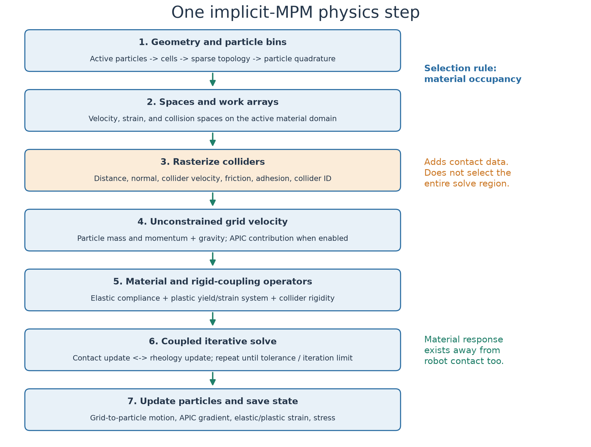
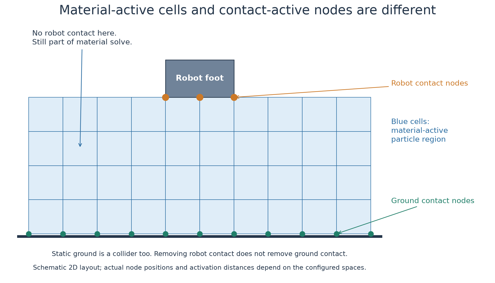
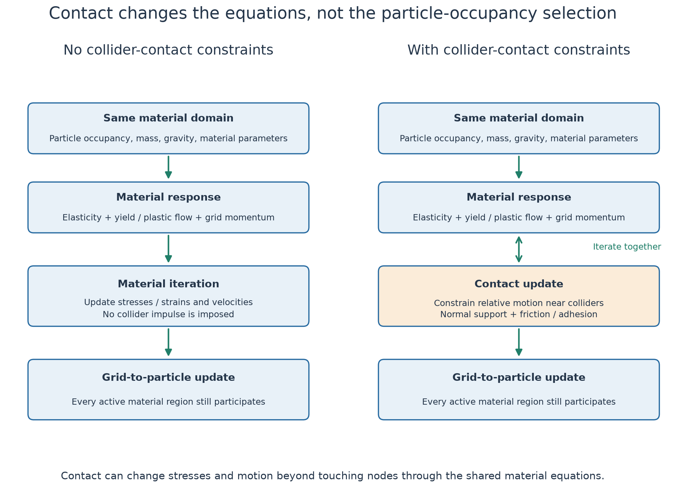

# How Newton's implicit MPM step works

This note describes the implementation in `newton/_src/solvers/implicit_mpm`,
with the moving-patch examples as context. It covers the **pipeline overview**,
each component, and **capacity overflow**. “Contact constraints” below means the
conditions imposed where material interacts with colliders.

The key distinction is:

> Particle occupancy selects the material domain. Collision rasterization adds
> contact information to that domain. Contact does not select the entire MPM solve.

## 1. Pipeline overview



The top-level `SolverImplicitMPM.step()` performs:

```text
_particles_to_cells()
    Locate particles and construct/rebuild the grid and active partition

_rebuild_scratchpad()
    Create/rebind the numerical spaces, fields, operators, and work arrays

_step_impl()
    Rasterize colliders
    Compute unconstrained grid velocity and inverse mass
    Build collider rigidity operator
    Build elasticity and plasticity systems
    Load warm starts
    Solve coupled material response and collider contact
    Update particles
    Save state needed by later steps
```

The PNG groups some adjacent operations for readability. The ordering above
follows the code. Collision rasterization appears early because it prepares
inputs for the later solve; it does not finish the collision response by itself.

For a particle/grid/NanoVDB animation, see the
[sparse-grid data-flow explanation](../sparse_capacity_sweep/README.md#2-what-makes-the-grid-sparse-and-what-nanovdb-does).

## 2. What each component does

### 2.1 Material particles: the persistent physical state

Particles represent samples of material. Their state includes position, velocity,
APIC velocity gradient, elastic strain, plastic deformation history, and stress.
The grid supports the numerical solve; particles carry material history between
steps.

`ParticleFlags.ACTIVE` is a simulation-enable flag, normally set by the builder
when particles are created. It is not inferred from robot contact or motion.
Untouched sand remains enabled in these examples. The MPM model also derives
transfer and material masks for special proxy/collider particles; those masks
are distinct from the contact-activation data described below.

### 2.2 Find occupied cells and build the grid

`_particles_to_cells()` uses the current particle positions:

- **Fixed grid:** reuse the regular grid fitted to the initial particle bounds
  plus padding, then rebuild its active-cell partition.
- **Rebuildable sparse grid:** update NanoVDB topology in the reserved storage,
  then build the active-cell partition.
- **Dynamic sparse grid:** allocate a new sparse topology for this step and use
  its grid domain directly.

For explicit partitions, `mark_active_cells()` checks the particle's `ACTIVE`
flag, looks up its grid cell, and marks that cell. A valid cell with at least one
enabled particle is active; 20 particles in one cell still mark only one cell.
The sparse rebuild mask additionally rejects non-finite particle positions.

This is spatial occupancy, not a robot-contact test. It does not ask whether the
sand is moving, being rendered, or currently deforming.

NanoVDB is the spatial index for the sparse grid. It provides topology and
coordinate lookup, while MPM uses separate numerical fields and work arrays.
Its leaf/lower/upper node counts are storage-block counts, not particle counts
or counts of contact points.

### 2.3 Bin particles and prepare numerical spaces

Warp FEM's `PicQuadrature` organizes particle samples within cells so field
integration and interpolation can use them. `_rebuild_scratchpad()` constructs
or rebinds the velocity, strain, and collision spaces and their associated
storage. The exact locations and number of numerical unknowns depend on the
chosen basis functions.

There are therefore several different counts:

| Count | What is being counted |
| --- | --- |
| Particles | Material samples |
| Active cells | Occupied spatial cells |
| Velocity/strain degrees of freedom | Unknowns of the numerical discretization |
| Contact-active nodes | Sampled collider constraints |
| NanoVDB nodes | Spatial-index storage blocks |

These quantities are related but are not interchangeable.

### 2.4 Collision rasterization: geometry becomes contact data

`_rasterize_colliders()` samples collider information in the collision space.
At each relevant node, it determines data such as:

| Data | Meaning |
| --- | --- |
| Signed distance | How far the sample is from a collider surface, including inside/outside information |
| Normal | Surface direction used to separate normal and tangential response |
| Collider velocity | Surface velocity against which material velocity is compared |
| Friction and adhesion | Surface-interaction parameters |
| Collider ID | Which collider receives the corresponding interaction |

In the current code, the contact activation distance passed to the rasterizer
is two voxel widths. A sample can therefore be activated near a collider before
literal geometric overlap. The rasterizer checks a signed-distance threshold;
“contact-active” does not mean exactly one colliding material particle exists at
that node.

For samples too far from a collider, the node data receives a null collider ID,
friction `-1`, and zeroed contact outputs. **This disables that contact response;
it does not deactivate the underlying material cell.** Depending on the velocity
and collision bases, the solver also constructs an operator mapping between the
two spaces.



In the illustration, all blue cells contain material. Only the orange nodes
represent robot-foot contact. The green nodes represent contact with the static
ground, which is another collider. Sand far from the robot may still have ground
contact, and sand with no collider contact still has material dynamics.

### 2.5 Particle-to-grid transfer and unconstrained velocity

`_compute_unconstrained_velocity()` integrates particle mass and momentum onto
the velocity space. It includes gravity over the time step. With APIC enabled,
it also includes the contribution from each particle's affine velocity gradient.
The implementation uses the integrated quantities to form inverse mass and an
initial grid velocity, with the configured background drag treatment.

“Unconstrained” means this velocity has not yet received the final implicit
material/contact corrections. It is the starting point for the solve, not the
final simulated motion.

### 2.6 Collider rigidity and two-way interaction

`_build_collider_rigidity_operator()` can account for finite-mass collider
response in the contact solve. A fixed wall and a movable body need not respond
the same way to an impulse. This component is conditional on the collider/model
configuration.

At the example level, `SolverCoupledProxy` manages the two-way rigid/MPM coupling.
Collider motion influences sand, and the coupling makes the resulting sand
interaction affect the rigid system. This outer coupling lifecycle is separate
from selecting which material cells exist in the MPM domain.

### 2.7 Material assembly: elasticity, strain, and plastic flow

`_build_elasticity_system()` assembles the compliance/elastic-response terms
where compliant material is present. Elasticity describes recoverable deformation
and its relationship to stress.

`_build_plasticity_system()` assembles strain-related terms and interpolates yield
parameters from material properties and plastic history, including `particle_Jp`.
Plasticity describes permanent deformation or flow when the material's admissible
stress conditions are reached. Other configured material features can affect
this system as well.

These calculations use the material domain and material masks. They are not
restricted to the cells touching the robot.

**Material friction and collider friction are different:** the material yield
model controls how sand resists internal shearing; collider friction controls
sliding along an external surface. Removing robot-contact constraints does not
remove the material's internal friction/plasticity model.

### 2.8 Coupled material/contact solve

`_solve_rheology()` passes three sets of information into `solve_rheology()`:

| Structure | Main contents |
| --- | --- |
| `MomentumData` | Grid velocity and inverse mass |
| `RheologyData` | Strain/compliance operators, yield parameters, stress and strain updates |
| `CollisionData` | Contact mapping, surface velocities/normals, friction, adhesion, and impulses |

In the iterative contact-capable path, `_run_solver_loop()` repeatedly executes
contact updates and rheology updates. Both affect the shared grid velocity.
The loop uses the configured convergence tolerance and iteration limit. CUDA
graph execution groups iterations, but does not change the selection rule to
“solve only where contact exists.”

Warm-start options can reuse a previous estimate to help convergence; they do
not change which particles represent simulated material.

### 2.9 Grid-to-particle transfer and material updates

`_update_particles()` updates elastic/plastic state and stress from the solved
fields where those material updates are enabled. It then transfers velocity and
velocity gradient to particles and advances their positions using the configured
PIC/APIC path. Some special material settings skip unnecessary state updates.

Particles without robot contact still participate. The changed particle
positions determine the occupied grid at the next step.

## 3. What changes with and without contact constraints?



Hold the particle set, initial state, material parameters, and voxel resolution
constant. A useful **schematic**, not the code's literal matrix equation, is:

```text
Without collider contact:
    M (v - v_free) = material impulse

With collider contact:
    M (v - v_free) = material impulse + J^T * contact impulse
```

Here `v_free` is the unconstrained grid velocity, `M` represents grid mass, and
`J` maps grid motion to the contact space. Material impulse depends on the
material response; it is not generally a constant external force.

### Without collider-contact constraints

The solver still performs particle/grid transfers and computes material
response. Sand can accelerate under gravity, deform elastically, and flow
plastically. It does not become frozen, collision-only, or computationally free.

There is no collider impulse enforcing separation or surface friction at the
removed contacts. If **all** collider constraints are absent, the ground cannot
support the material through this contact mechanism. If **only robot contact**
is disabled while ground contact remains, ground support remains but the robot
and sand no longer exchange those contact forces.

“No active contacts” also does not guarantee zero contact-related implementation
overhead: fields can still be allocated and contact kernels can still process
inactive entries. Do not infer runtime purely from the number of physical
contacts.

### With collider-contact constraints

The solve considers material motion relative to the collider's surface velocity.
For ordinary nonadhesive frictional contact, the intended response includes normal
support against penetration and tangential stick/slip governed by friction.
Adhesion and finite-mass collider response modify that picture when configured.

For example, a foot pressing into sand changes nearby velocities through contact
impulses. Those velocity changes modify strain and stress, which can change the
response of surrounding material. Contact and material updates therefore need to
be solved together rather than treating contact as a mask that removes all
non-touching material from the solve.

| Aspect | Without contact constraints | With contact constraints |
| --- | --- | --- |
| Particle-occupancy selection | Still used | Still used |
| Mass transfer and gravity | Still computed | Still computed |
| Elastic/plastic response | Still computed | Computed with contact-influenced motion |
| Collider separation and surface friction | Not imposed at the disabled contacts | Imposed through the contact response |
| Particle state and transfers | Still required | Still required |
| Cost | Material and transfer work remains | Additional contact work; convergence may also change |

Removing contact is **not** a way to restrict MPM to a local neighborhood of the
robot. That requires a separate material-activation strategy or a bounded moving
patch with suitable boundary treatment.

## 4. Where rendering and moving-patch recycling fit

The moving-patch example calls `recycle_terrain()` before its coupled physics
step. It relocates outgoing background particles and resets their material
state. This is example-level work added to the solver pipeline.

Rendering happens in `render()`, after simulation stepping. Changing visibility
does not change particle flags or the material domain in these examples.

A large bed therefore costs more even with **rendering disabled and no recycling**:
there are more particle states, more transfers and updates, more occupied cells,
and larger material operators/workspaces. Which component dominates requires
profiling. It is not established that rendering or resetting particles is the
main limitation.

The moving patch adds recycling overhead while bounding the simulated particle
population. Its scaling benefit comes from simulating a bounded neighborhood,
not from collision rasterization selecting only particles near the robot.

## 5. Capacity overflow and other failure modes

“Pipeline overview” and “overflow” describe different things. Overflow means a
reserved storage budget is exceeded; it is not a stage of the normal pipeline.

| Failure | What it means | Relevant response |
| --- | --- | --- |
| Active-voxel capacity exceeded | The sparse rebuild needs more active cells than reserved | Increase `max_active_cell_count` or bound the active domain |
| Leaf/lower/upper capacity exceeded | The particle distribution needs more NanoVDB nodes at that hierarchy level | Increase the corresponding node capacity or bound spatial spread |
| Device out of memory | Total allocations exceed available VRAM | Reduce workload/reservations or free competing GPU memory |
| Unsupported allocation during CUDA capture | The chosen allocation path requires operations unavailable in capture | Use the bounded rebuildable path or run without the outer graph |
| Poor convergence / non-finite state | Numerical or physical-model issue, not necessarily storage overflow | Inspect time step, inputs, material/coupling settings, solver diagnostics |

`_sparse_grid_rebuild_error()` reports which capacity was exceeded. Status bits
can indicate several exceeded budgets at once. The solver accumulates rebuild
status for graph replay; check `check_sparse_grid_rebuild_status()` after replay
at appropriate diagnostic points. Do not treat an overflowed run as a valid
lower-cost simulation.

Capacity is not occupancy. Reserving more leaves does not activate more terrain,
and increasing a limit does not improve voxel resolution. Conversely, overly
large reservations can consume unnecessary memory and affect capacity-sized
bookkeeping or solver work.

The detailed capacity explanation and PNGs are in
[the sparse-capacity README](../sparse_capacity_sweep/README.md#what-the-parameters-control).
No optimal capacity recommendation is established by this walkthrough; the
benchmark sweep remains paused while the other GPU batch is running.

## 6. Code map

All paths below are relative to this checkout. The functions are the best search
anchors if later edits move line numbers.

| Source | Functions to inspect |
| --- | --- |
| [`solver_implicit_mpm.py`](../../../_src/solvers/implicit_mpm/solver_implicit_mpm.py) | `step`, `_particles_to_cells`, `_create_geometry_partition`, `_rebuild_scratchpad`, `_step_impl` |
| [Same solver file](../../../_src/solvers/implicit_mpm/solver_implicit_mpm.py) | `_rasterize_colliders`, `_compute_unconstrained_velocity`, `_build_collider_rigidity_operator`, `_build_elasticity_system`, `_build_plasticity_system`, `_solve_rheology`, `_update_particles` |
| [`implicit_mpm_model.py`](../../../_src/solvers/implicit_mpm/implicit_mpm_model.py) | `_refresh_particle_flags_and_extrema`: transfer/material masks |
| [`implicit_mpm_solver_kernels.py`](../../../_src/solvers/implicit_mpm/implicit_mpm_solver_kernels.py) | `build_active_particle_mask`, `mark_active_cells`, `_rebuild_capacity` |
| [`rasterized_collisions.py`](../../../_src/solvers/implicit_mpm/rasterized_collisions.py) | `rasterize_collider`, per-node SDF/contact activation, `build_rigidity_operator` |
| [`solve_rheology.py`](../../../_src/solvers/implicit_mpm/solve_rheology.py) | `MomentumData`, `RheologyData`, `CollisionData`, `_NodalContactSolver`, `_SubgridContactSolver`, `_run_solver_loop`, `solve_rheology` |
| [`moving_patch_mpm.py`](../impl/moving_patch_mpm.py) | Example-level background recycling and render visibility |

Regenerate this note's PNGs with CPU-only plotting:

```bash
uv run --no-sync newton/examples/mpm_moving_patch_alpha/doc/illustrate_mpm_lowlevel.py
```
