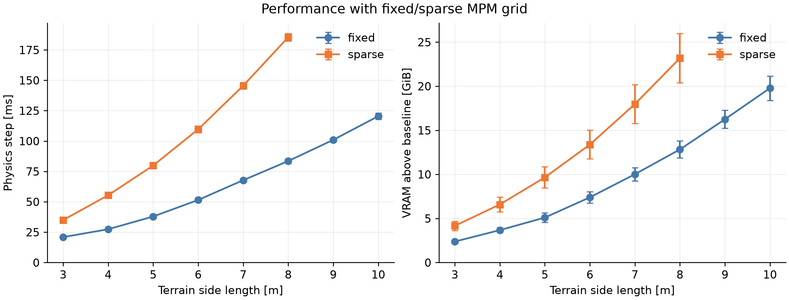
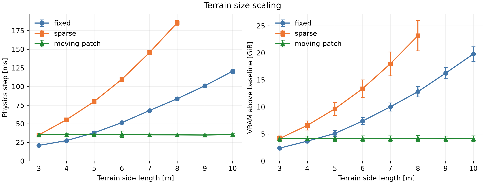

# Alpha box benchmark: 3-10 m terrain

Run date: 2026-09-28T08:35:14-0700. Status: complete; 48/48 attempts recorded, 44 successful, 4 excluded.

This rerun measures the updated alpha box example with fixed, sparse, and moving-patch terrain. Alpha discards terrain history when particles are recycled. The box remains dynamic and exchanges forces with the sand; a force controller follows a straight reference at 0.2 m/s.

## Setup

| Parameter | Value |
| --- | --- |
| Background terrain | 3 x 3 through 10 x 10 m, in 1 m increments |
| Moving-patch simulated terrain | 2 x 2 m |
| Boundary terrain | 0.5 m on each side; ACTIVE particles with zero mass |
| Moving-patch total particle region | 3 x 3 x 0.5 m; 1,004,400 particles |
| Fixed/sparse total particle region | L x L x 0.5 m; includes the 0.5 m boundary on each side |
| Sampling | 0.05 m voxels; 3 particles per voxel axis; jitter 0.05/3 m |
| Material | Density 2,500 kg/m³; Young's modulus 40 MPa; Poisson's ratio 0.3; friction tan(50°) |
| Solver | PIC; P0 strain; Q1 velocity; S2 collider; max 50 iterations; warmstart auto |
| Cell capacity setting | max(65,536, ceil(particle width / 0.05 + 8)² x 22) |
| Physics | 50 Hz x 4 substeps = 200 Hz; four rigid substeps per coupled step |
| Coupling | Two-way proxy coupling; one coupling iteration; mass scale 1 |
| Box | Current example geometry: 0.5 x 0.7 x 0.5 m; finalized mass 250 kg |
| Execution | ViewerNull; no rendering; no outer CUDA graph capture |
| Measurements | 150 warm-up steps + 150 measured steps; two fresh-process repeats |
| GPU | NVIDIA GeForce RTX 5090, 32 GiB |

Material, sampling, solver settings, and the short-run protocol are retained from the previous physics/VRAM benchmark. They override the interactive example defaults (including density, sand depth, and warmstart). The updated box geometry and alpha implementation are used. Unlike the previous run, the background has exactly the plotted size; no extra 2 m margin is added.

The alpha, implicit-MPM, and coupled-solver Python source hashes match the archived September 26 snapshot in physics_vram/source_hashes.json. These are fresh measurements of the current checkout; they do not establish a speedup from a source change relative to that snapshot. Software versions and the current source hashes are recorded alongside the results.

Sparse uses a positive max_active_cell_count and rebuilds its reserved grid in place. NanoVDB node capacities retain their default automatic, worst-case reservations. This is the previous benchmark's capacity policy, not a sweep for the lowest valid capacities or a test of per-step dynamic allocation with max_active_cell_count=-1. The cell-capacity column records the configured limit; fixed and sparse can allocate different internal buffers despite the same setting.

Physics time is wall time for one coupled physics step, synchronized with the GPU. It includes control, collision detection, coupling, MPM, and moving-patch maintenance. Error bars show mean ± sample standard deviation across the pooled step measurements, not uncertainty in the mean. VRAM is device-wide NVML usage minus the pre-CUDA baseline, sampled every 50 ms. Steady VRAM is averaged over the measured interval and final state checks; peak includes initialization and warm-up. Shorter memory peaks can be missed, and desktop graphics can affect the baseline.

The runner waits for other GPU compute processes and excludes overlapping runs. It checks for sparse-capacity errors, solver warnings, and non-finite final rigid/particle positions and velocities. Passing these checks does not establish long-duration stability. Each short run covers 1.5 s total, including warm-up; this measures terrain-size scaling, not traversal of the entire background.

## Results





Missing points are failed cases, not zero-cost simulations. See the exclusions below.

| Side [m] | Method | Successful repeats | Physics step [ms], mean ± std | Steady VRAM [GiB], mean ± std | Sampled peak [GiB] |
| ---: | --- | ---: | ---: | ---: | ---: |
| 3 | fixed | 2/2 | 20.91 ± 1.07 | 2.38 ± 0.15 | 2.64 |
| 3 | moving-patch | 2/2 | 35.39 ± 1.70 | 4.12 ± 0.53 | 4.91 |
| 3 | sparse | 2/2 | 34.94 ± 1.28 | 4.16 ± 0.52 | 4.95 |
| 4 | fixed | 2/2 | 27.40 ± 1.36 | 3.67 ± 0.27 | 4.00 |
| 4 | moving-patch | 2/2 | 35.24 ± 1.39 | 4.12 ± 0.51 | 4.91 |
| 4 | sparse | 2/2 | 55.37 ± 1.79 | 6.58 ± 0.83 | 7.63 |
| 5 | fixed | 2/2 | 37.88 ± 1.62 | 5.10 ± 0.54 | 5.82 |
| 5 | moving-patch | 2/2 | 35.37 ± 1.27 | 4.14 ± 0.52 | 4.97 |
| 5 | sparse | 2/2 | 79.85 ± 2.09 | 9.66 ± 1.19 | 11.03 |
| 6 | fixed | 2/2 | 51.51 ± 1.50 | 7.39 ± 0.63 | 7.99 |
| 6 | moving-patch | 2/2 | 36.07 ± 4.44 | 4.17 ± 0.51 | 5.00 |
| 6 | sparse | 2/2 | 109.67 ± 2.71 | 13.38 ± 1.63 | 15.15 |
| 7 | fixed | 2/2 | 67.77 ± 1.57 | 10.01 ± 0.75 | 10.59 |
| 7 | moving-patch | 2/2 | 35.08 ± 1.44 | 4.13 ± 0.54 | 4.94 |
| 7 | sparse | 2/2 | 145.55 ± 2.79 | 17.98 ± 2.21 | 20.07 |
| 8 | fixed | 2/2 | 83.54 ± 1.93 | 12.83 ± 0.97 | 13.56 |
| 8 | moving-patch | 2/2 | 35.05 ± 1.22 | 4.16 ± 0.53 | 4.91 |
| 8 | sparse | 2/2 | 185.47 ± 3.17 | 23.18 ± 2.79 | 25.66 |
| 9 | fixed | 2/2 | 100.97 ± 1.84 | 16.25 ± 1.02 | 16.90 |
| 9 | moving-patch | 2/2 | 34.90 ± 1.18 | 4.11 ± 0.53 | 4.91 |
| 9 | sparse | 0/2 | failed | failed | failed |
| 10 | fixed | 2/2 | 120.46 ± 2.60 | 19.78 ± 1.38 | 20.66 |
| 10 | moving-patch | 2/2 | 35.37 ± 1.32 | 4.13 ± 0.53 | 4.92 |
| 10 | sparse | 0/2 | failed | failed | failed |

## Interpretation

For fixed, increasing the terrain side from 3 to 10 m changes mean physics time from 20.91 to 120.46 ms and steady VRAM from 2.38 to 19.78 GiB.

For sparse, increasing the terrain side from 3 to 8 m changes mean physics time from 34.94 to 185.47 ms and steady VRAM from 4.16 to 23.18 GiB.

For moving-patch, increasing the terrain side from 3 to 10 m changes mean physics time from 35.39 to 35.37 ms and steady VRAM from 4.12 to 4.13 GiB.

Only moving-patch keeps its particle region and reserved cell capacity constant as the background grows. Fixed and sparse both simulate the full particle bed; sparse allocation does not restrict the material solve to particles touching the box. The 3 m cases have equal particle allocation, so comparing moving-patch with sparse at 3 m estimates total patch-maintenance overhead under this short-run protocol. Comparing moving-patch with fixed also includes a grid-method difference. These results concern a flat, densely filled bed and this reservation policy; they are not a claim about all sparse-grid configurations.

The box moves during the size sweep, but does not travel far enough to shift the patch center (centers are spaced 0.4 m apart) before the short run ends. No patch shifts occur during the measured interval. Per-step patch checks are timed; particle recycling during a shift is covered by the longer run below.

## Particle allocation and patch movement

| Side [m] | Method | Particles | Cell capacity setting | Active cells at end | Patch shifts during measurement, by repeat |
| ---: | --- | ---: | ---: | --- | --- |
| 3 | fixed | 1,004,400 | 101,728 | 43,186-43,186 | [0, 0] |
| 3 | moving-patch | 1,004,400 | 101,728 | 40,931-40,931 | [0, 0] |
| 3 | sparse | 1,004,400 | 101,728 | 40,931-40,931 | [0, 0] |
| 4 | fixed | 1,785,600 | 170,368 | 76,767-76,767 | [0, 0] |
| 4 | moving-patch | 1,004,400 | 101,728 | 40,931-40,931 | [0, 0] |
| 4 | sparse | 1,785,600 | 170,368 | 72,171-72,171 | [0, 0] |
| 5 | fixed | 2,790,000 | 256,608 | 119,941-119,941 | [0, 0] |
| 5 | moving-patch | 1,004,400 | 101,728 | 40,931-40,931 | [0, 0] |
| 5 | sparse | 2,790,000 | 256,608 | 112,211-112,211 | [0, 0] |
| 6 | fixed | 4,017,600 | 360,448 | 172,732-172,732 | [0, 0] |
| 6 | moving-patch | 1,004,400 | 101,728 | 40,931-40,931 | [0, 0] |
| 6 | sparse | 4,017,600 | 360,448 | 161,051-161,051 | [0, 0] |
| 7 | fixed | 5,468,400 | 481,888 | 235,094-235,094 | [0, 0] |
| 7 | moving-patch | 1,004,400 | 101,728 | 40,931-40,931 | [0, 0] |
| 7 | sparse | 5,468,400 | 481,888 | 218,691-218,691 | [0, 0] |
| 8 | fixed | 7,142,400 | 620,928 | 307,080-307,080 | [0, 0] |
| 8 | moving-patch | 1,004,400 | 101,728 | 40,931-40,931 | [0, 0] |
| 8 | sparse | 7,142,400 | 620,928 | 285,131-285,131 | [0, 0] |
| 9 | fixed | 9,039,600 | 777,568 | 388,629-388,629 | [0, 0] |
| 9 | moving-patch | 1,004,400 | 101,728 | 40,931-40,931 | [0, 0] |
| 10 | fixed | 11,160,000 | 951,808 | 479,819-479,819 | [0, 0] |
| 10 | moving-patch | 1,004,400 | 101,728 | 40,931-40,931 | [0, 0] |

## Longer moving-patch validation

The 6 x 6 m background uses the same 2 x 2 m simulated terrain and 0.5 m boundary. Each repeat runs 150 warm-up steps followed by 1,200 measured steps. These measurements are separate from the terrain-size plots.

Repeat 0: 35.35 ± 1.70 ms per step; 4.14 GiB steady VRAM; 2 patch shifts during the 6 s measured interval; final box X = 0.78 m.

Repeat 1: 35.39 ± 1.54 ms per step; 4.14 GiB steady VRAM; 2 patch shifts during the 6 s measured interval; final box X = 0.78 m.

## Excluded attempts

- scaling_box_sparse_10, repeat 0: failed; RuntimeError: Failed to allocate 2055905280 bytes on device 'cuda:0'
- scaling_box_sparse_10, repeat 1: failed; RuntimeError: Failed to allocate 2055905280 bytes on device 'cuda:0'
- scaling_box_sparse_9, repeat 0: failed; RuntimeError: Failed to allocate 1679546880 bytes on device 'cuda:0'
- scaling_box_sparse_9, repeat 1: failed; RuntimeError: Failed to allocate 1679546880 bytes on device 'cuda:0'

## Reproduce

```bash
uv run --no-sync python newton/examples/mpm_moving_patch_alpha/benchmark/box_2026_09_28/rerun.py
uv run --no-sync python newton/examples/mpm_moving_patch_alpha/benchmark/box_2026_09_28/plot_results.py
```

The runner retains successful results. Use a new output directory for a different source revision. Raw JSON/logs, individual timing samples, summary CSV/JSON, source hashes, and environment metadata are saved beside this report. The figure PDFs and report.tex can be compiled with LaTeX elsewhere; no local pdflatex or latexmk executable was found.
