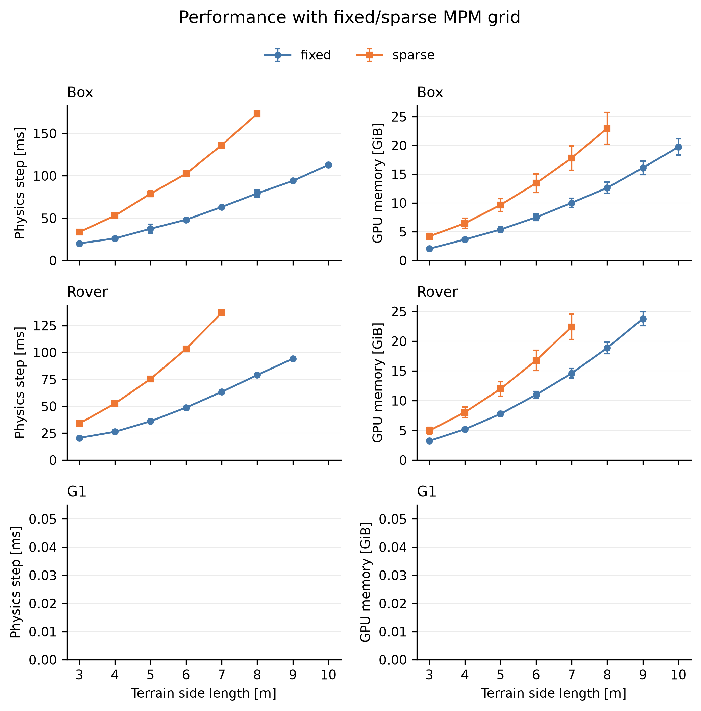
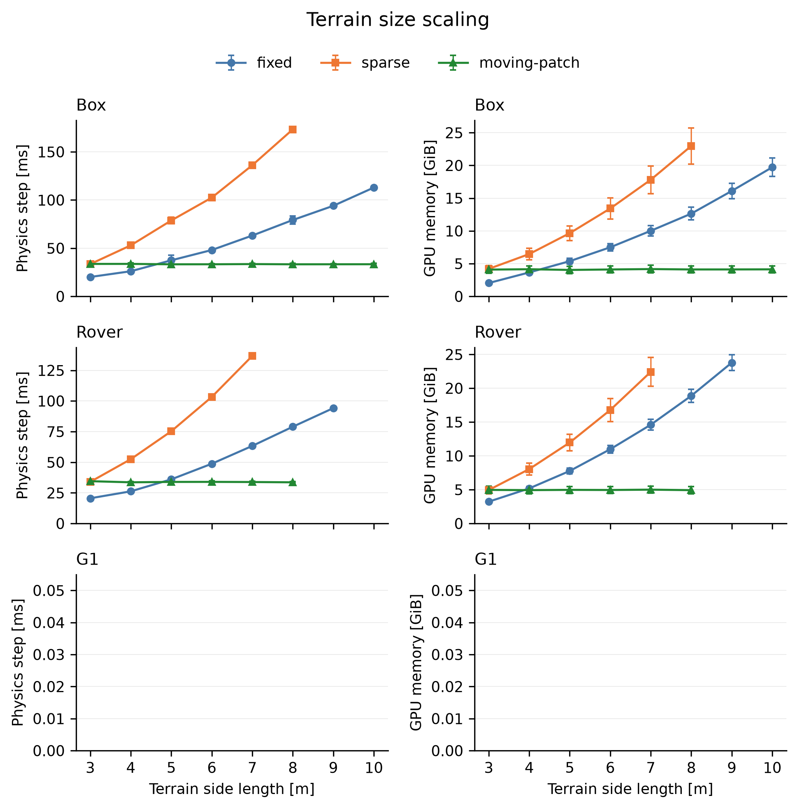
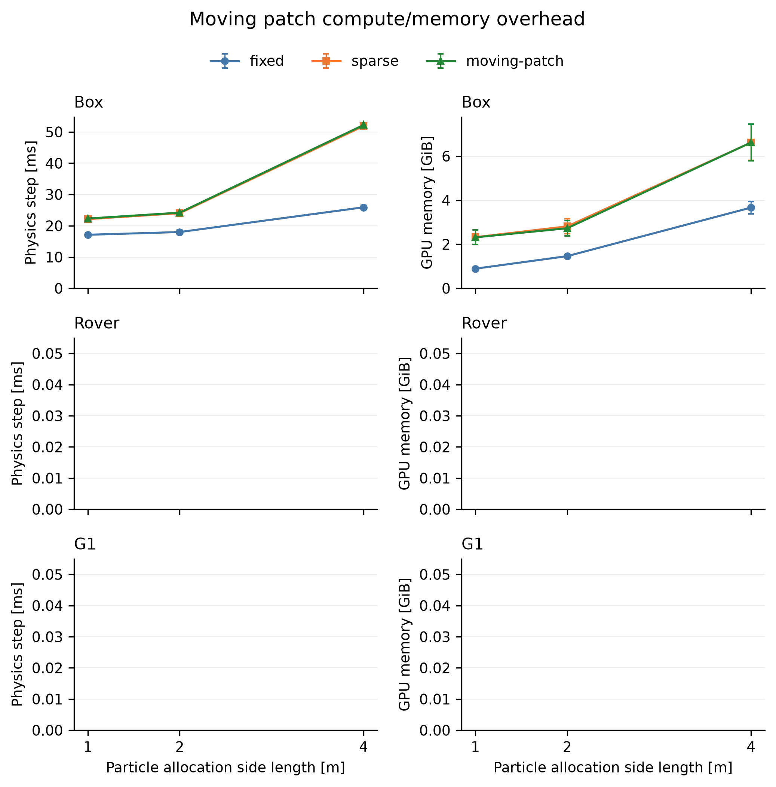

# Alpha physics speed and GPU memory benchmark

Status: in progress; 52/204 attempts recorded, 49 successful. Failed or contended attempts are excluded from plotted means.

These runs use the current standalone alpha box, rover, and G1 examples. Alpha discards terrain history: recycled particles represent fresh sand. Each scene uses the same benchmark material and particle sampling. The default interactive material settings are overridden only in the benchmark subclass.

## Conditions

| Parameter | Value |
| --- | --- |
| GPU | NVIDIA GeForce RTX 5090, 32 GiB |
| Physics | 200 Hz coupled steps; 4 rigid substeps per coupled step |
| Rendering | Disabled (ViewerNull) |
| Material | Density 2,500 kg/m³; Young's modulus 40 MPa; Poisson's ratio 0.3; friction tan(50°) |
| Sampling | 0.05 m voxels; 3 particles per cell axis; 0.5 m depth; jitter 0.05/3 m |
| MPM solve | PIC transfer; P0 strain basis; maximum 50 iterations |
| Grid capacity | max(65,536, ceil(width/0.05 + 8)² x 22) cells |
| Sparse allocation | Positive reserved capacity; rebuildable sparse grid |
| Motion | Box force tracking; grouser-wheel rover differential drive; G1 policy; forward command 0.2 m/s |
| Short runs | 150 warm-up steps + 150 measured steps; two fresh-process repeats |
| Longer moving-patch runs | 150 warm-up steps + 1,200 measured steps; two repeats |

The box mass is 250 kg; the grouser-wheel rover is approximately 38.11 kg; G1 is approximately 33.34 kg. G1 uses `config/g1.yaml`, `config/policy_3d_rft.pt`, and the improved-collision box-foot MJCF asset. The box force controller is applied only to the box; robot control comes from wheel actuators or the G1 policy.

Physics time is synchronized wall time for one coupled step. It includes collision detection, rigid/MPM coupling, particle recycling, and control (including G1 policy inference at 50 Hz). It excludes scene construction, rendering, and final CPU state checks. No CUDA frame graph is used. Error bars show the sample standard deviation of individual steps pooled across repeats, not confidence intervals. Repeat means are retained in summary.json.

Sparse uses a preallocated, rebuildable grid with the capacity formula above. This comparison does not benchmark negative-capacity dynamic allocation or search for optimal sparse capacities. Raw results include the reserved capacity and the occupied-cell count at the end of each run.

GPU memory is device-wide NVML usage minus the pre-CUDA baseline, sampled every 50 ms. Steady memory covers the measured interval through final state checks. Sampled peak includes initialization and warm-up and can miss shorter peaks. Desktop graphics remain active and can introduce small fluctuations. Other compute processes are monitored; overlapping runs are excluded. VRAM includes arrays allocated by the example during construction even when rendering is disabled. Raw files also record Warp pool memory, which does not include all solver or PyTorch allocations.

## Terrain size scaling

Fixed and sparse simulate an L x L x 0.5 m bed, for L = 3 through 10 m. Moving-patch keeps a 3 x 3 x 0.5 m bed: a 2 x 2 m moving terrain area and a 0.5 m zero-mass active boundary on each side. Fixed and sparse use the same boundary width at the edges of their full beds. All methods have sampled background ground of side L + 2 m. Thus the horizontal axis describes particle-bed size for full-terrain methods and available terrain extent for moving-patch; it is not a common particle allocation.





| Scene | Method | Side [m] | Physics step [ms], mean ± std | Steady VRAM [GiB], mean ± std | Sampled peak [GiB] | Particles |
| --- | --- | ---: | ---: | ---: | ---: | ---: |
| box | fixed | 3 | 20.15 ± 0.88 | 2.04 ± 0.19 | 2.56 | 1,004,400 |
| box | sparse | 3 | 33.52 ± 1.04 | 4.20 ± 0.49 | 4.91 | 1,004,400 |
| box | moving-patch | 3 | 33.70 ± 1.04 | 4.09 ± 0.53 | 4.91 | 1,004,400 |
| box | fixed | 10 | 112.93 ± 1.14 | 19.72 ± 1.41 | 20.69 | 11,160,000 |
| box | moving-patch | 10 | 33.37 ± 1.13 | 4.13 ± 0.53 | 4.88 | 1,004,400 |
| rover | fixed | 3 | 20.60 ± 0.59 | 3.23 ± 0.15 | 3.45 | 1,004,400 |
| rover | sparse | 3 | 33.97 ± 0.78 | 4.95 ± 0.56 | 5.82 | 1,004,400 |
| rover | moving-patch | 3 | 34.54 ± 0.74 | 4.97 ± 0.53 | 5.72 | 1,004,400 |

## Equal particle allocation

All three methods allocate the same initial 1, 2, or 4 m particle-bed width, with a 0.1 m zero-mass active boundary on each side. Differences include patch maintenance and the resulting material motion. This is an end-to-end comparison, not an isolated measurement of one recycling kernel.



## Longer moving-patch runs

The short runs may not move far enough to shift a patch. These additional runs measure six seconds after warm-up with the default 0.4 m patch shift interval. The patch shift count below is the difference between the counters before and after measurement.

| Scene | Repeat | Physics step [ms], mean ± std | Steady VRAM [GiB] | Patch shifts during measurement |
| --- | ---: | ---: | ---: | ---: |

## Interpretation

For box, fixed changes from 20.15 to 112.93 ms and from 2.04 to 19.72 GiB between 3 and 10 m.
For box, moving-patch changes from 33.70 to 33.37 ms and from 4.09 to 4.13 GiB between 3 and 10 m.
At equal 2 m allocation for box, fixed takes 17.99 ms, sparse 24.01 ms, and moving-patch 24.19 ms. Moving-patch differs from sparse by 0.8 percent.
Moving-patch versus fixed includes both the grid-method difference and patch maintenance. The equal-allocation comparison against sparse more closely measures added patch handling, although material motion can also differ.

Moving-patch keeps its particle count bounded, while full-terrain particle counts grow with horizontal area. Background height samples still grow with terrain extent; bounded MPM allocation does not mean all memory is independent of background size. Alpha also updates a local supporting collider and particle masses when boundary membership changes.

These results are not a direct alpha-versus-beta comparison. Alpha preserves both vertical sampling endpoints (31 layers here, versus beta's 30). Robot assets, current solver source, and ground-collider handling can also differ. The benchmark uses alpha's current scene code.

State checks reject non-finite rigid/particle positions and velocities; solver overflow warnings are excluded. Passing these checks does not establish long-distance locomotion stability or guarantee that every step of a G1 run is upright. The short scaling runs do not traverse the entire terrain. Initial, measurement-start, and final poses are saved.

## Excluded attempts

- scaling_box_sparse_10, repeat 0: failed; RuntimeError: Failed to allocate 2055905280 bytes on device 'cuda:0'
- scaling_box_sparse_9, repeat 0: failed; RuntimeError: Failed to allocate 1679546880 bytes on device 'cuda:0'
- scaling_rover_sparse_8, repeat 0: failed; RuntimeError: Failed to allocate 1341204480 bytes on device 'cuda:0'

## Reproduce

```bash
uv run --no-sync python newton/examples/mpm_moving_patch_alpha/benchmark/physics_vram/run_benchmarks.py
uv run --no-sync python newton/examples/mpm_moving_patch_alpha/benchmark/physics_vram/plot_results.py
```

The runner retains successful existing results. Use a clean output directory for a new experiment. Raw JSON/logs, summary CSV/JSON, source hashes, asset hashes, and environment metadata are saved here. No local LaTeX compiler was found; report.tex and PDF figures can be compiled elsewhere using `latexmk -pdf report.tex`.
