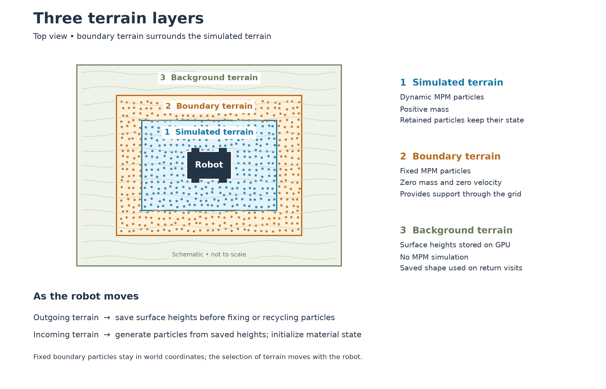
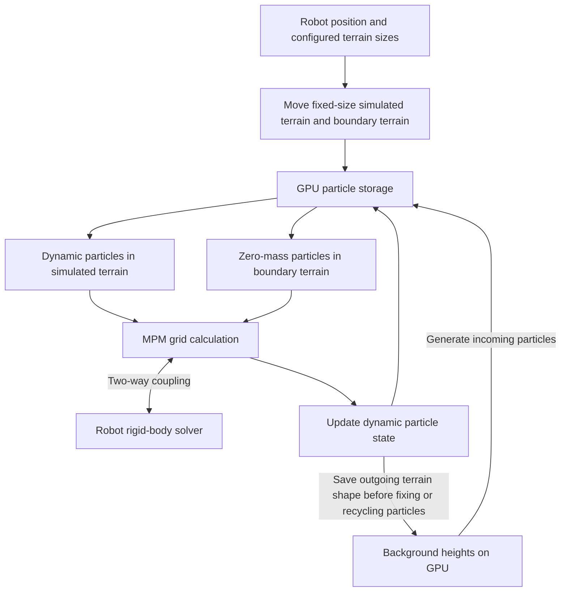
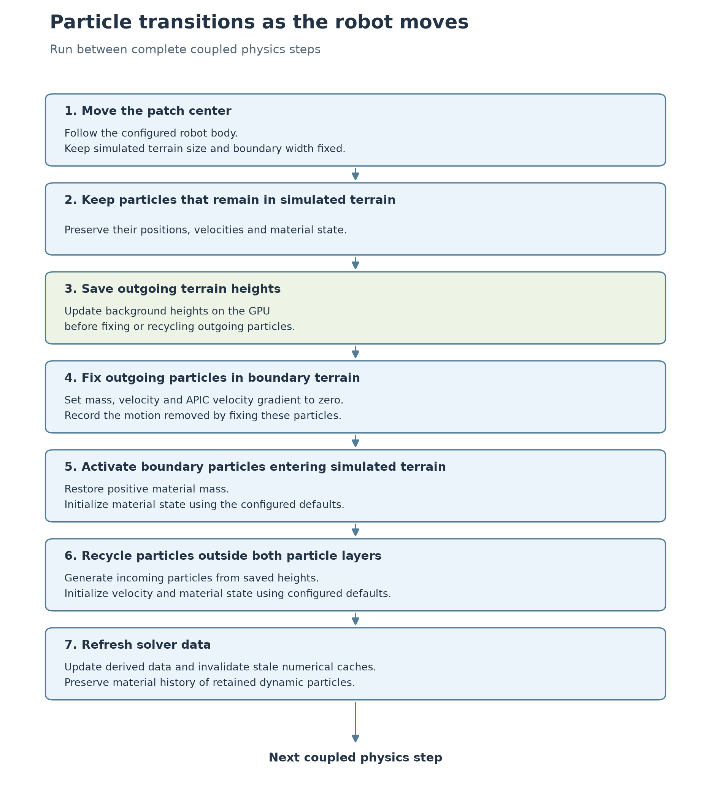

# Implementation plan: simulate local terrain with MPM and save terrain heights

Status: design only. The interfaces below are not implemented.

## 1. Motivation and idea

A robot traveling across sand needs the terrain beneath its feet or wheels to
move and deform. When it returns to a previously visited area, its tracks should
still exist. Simulating every particle across a large terrain makes computation
and GPU memory grow with terrain size. A sparse MPM grid avoids empty space but
still processes material away from robot contact.

We will simulate terrain near the robot and save the shape of background terrain
as surface heights on the GPU. As the robot moves, we will update background
heights from outgoing particles and generate incoming particles from saved
heights. This extends the moving-patch approach with persistent terrain shape.

We will preserve full MPM state for particles that stay in simulated terrain.
When particles are recycled, we will initialize their material state using the
configured defaults. We will not preserve background velocity, stress, or plastic
deformation history in the first version. A return visit restores terrain shape,
not its full physical state.

## 2. Terrain configuration

| Layer | Representation | Behavior |
|---|---|---|
| Robot-centric simulated terrain | Dynamic MPM particles with positive mass | Normal MPM and two-way robot coupling; particles that remain here retain their state |
| Boundary terrain | Zero-mass MPM particles with prescribed zero velocity | Provides fixed support around the simulated terrain; participates in the grid calculation but does not flow like dynamic sand |
| Background terrain | Surface heights in GPU arrays | No MPM solve; heights change when outgoing simulated terrain is saved |



We will use **simulated terrain** for the robot-centric area with dynamic
particles, **boundary terrain** for the surrounding fixed particles, and
**background terrain** for terrain represented only by heights. **GPU particle
storage** holds particles for the first two layers. A **terrain tile** is a piece
of the height array used to organize updates; it is not an MPM grid cell.

Particles are not attached to a layer permanently. As the robot moves, particles
may move from simulated terrain into boundary terrain and eventually be recycled.
Particles retained in simulated terrain will not be reset during that update.

The boundary terrain is a physical approximation of support from surrounding
sand. It is not a rendering fade band. We will control particle visibility
separately from these three layers.



### Zero-mass boundary behavior in Newton

Newton's `SolverImplicitMPM` has explicit support for kinematic particles:
`integrate_mass` treats zero particle density as an effectively infinite grid-mass
contribution, and `integrate_velocity` uses prescribed velocity without gravity
for those particles. Particle density is calculated from particle mass and
particle volume. The particle collision projection also skips zero-mass particles.

We will therefore test zero mass, zero velocity and zero APIC velocity gradient
for boundary particles. We will keep their particle volume valid and keep them
included in the required MPM transfers. Disabling their `ACTIVE` flag would remove
the support they are intended to provide.

The fixed support acts through grid interpolation. It can constrain nearby
dynamic particles that share grid nodes, so it is not an infinitely thin wall.
We will configure the simulated terrain size and boundary width explicitly and
validate those settings before running the example. These sizes will not adapt
during simulation. The configured simulated terrain must be large enough to
contain the robot's contacts, including extended limbs, with a margin.

Boundary terrain will remain fixed in world coordinates while its particles are
retained. Moving the robot-centric area will change which particles belong to
boundary terrain; it will not drag a fixed ring through the sand.

## 3. Background terrain

We will store surface heights in GPU arrays. Each array or terrain tile needs:

- A horizontal origin and sample spacing.
- One float32 surface height per sample.
- A definition of the ground beneath the sand, and shared material parameters.
- Update metadata identifying which samples contain saved terrain changes.

A height sample describes the sand surface over a horizontal location, not the
height of an individual particle. We will generate particles between the ground
beneath the sand and that surface. We will not create a rigid collider at the sand
surface: doing that would replace deformable support with rigid support.

We will start with a finite GPU height array and explicit bounds. Its storage is
approximately `4 * sample_count_x * sample_count_y` bytes, excluding metadata and
temporary arrays. A 100 m by 100 m terrain sampled every 2.5 cm is approximately
64 MB. Sampling spacing can differ from MPM voxel size.

This avoids routine CPU/GPU terrain transfers. It does not provide unlimited
terrain storage: height memory grows with mapped area. A later implementation
can allocate height tiles only where needed and move tiles to CPU or disk when
GPU memory is exhausted. The first version of `MovingPatchMPM` will use a finite background height array.

### Converting particles to heights

We will reconstruct outgoing surface heights on the GPU before recycling particles
or changing dynamic particles to fixed boundary particles. We will update only
the affected horizontal samples.

Taking the highest particle at each sample is insufficient: isolated airborne
particles can create false peaks, while gaps between samples can erase material.
We will first evaluate reconstruction from deposited particle volume, using the
underlying ground and an explicit bulk-density assumption. The reconstruction
must represent both depressions and piles and must not repeatedly add the same
particle volume to previously saved heights.

Each update will replace the saved heights for its owned terrain area using the
current particle data. Updates near tile edges will gather neighboring particle
contributions with a defined ownership rule to avoid seams or double counting.
Boundary particles are support samples, not additional newly deposited material.

We will measure material volume before and after conversion and regeneration.
Exact compaction cannot be retained by a height-only representation with fixed
sampling density. That approximation must be visible in validation results.

## 4. Simulated and boundary terrain

We will define the three layers using fixed configuration values:

| Configuration value | Python type | Units | Meaning |
|---|---|---|---|
| `moving_terrain_size` | `tuple[float, float]` | m | Full horizontal size `(size_x, size_y)` of simulated terrain; both values must be positive. |
| `boundary_terrain_size` | `float` | m | Thickness of boundary terrain on each side; must be positive. |
| `background_terrain_size` | `tuple[float, float]` | m | Full horizontal size `(size_x, size_y)` of the background height array; both values must be positive. |
| `background_terrain_origin` | `tuple[float, float]` | m | Fixed world coordinates `(center_x, center_y)` of the center of background terrain. |

The wrapper also uses the following configuration values and inputs shown in
section 5:

| Value | Python type | Units | Meaning |
|---|---|---|---|
| `background_height_spacing` | `float` | m | Distance between neighboring samples of the background terrain surface height, equal along X and Y; independent of MPM voxel size and particle spacing. Must be positive. |
| `tracked_body` | `str` | body name | Name of the robot body whose horizontal position defines the patch center. The wrapper resolves its body index internally. |

We will derive the initial patch center from the tracked body's initial world
position; there will be no `initial_patch_center` argument. We will resolve
`tracked_body` against Newton's body labels (`model.body_label` after model
finalization), with a clear error if the name is missing or ambiguous. For batched
environments, we will resolve the name within each environment. Users will not
need to look up body indices.

We will also remove `particle_capacity` from the user configuration. Particle
storage size will be calculated internally from simulated terrain size, boundary
width, sand depth, MPM voxel size, and particles per cell. It is the actual GPU
allocation size, not just an initial memory check. We will retain internal checks
that the sampled terrain fits the allocated storage. If saved terrain heights
require more particles than this allocation supports, the implementation must
report that condition or resize at an uncaptured maintenance step; it must not
silently drop material.

Two-component values use `tuple[float, float]` to specify exactly two numbers.
In Python, a two-element list would be annotated as `list[float]` with its length
checked separately, not `list[float, float]`. These types describe the planned
Python interface; GPU kernels will use the corresponding Warp values and arrays.

The simulated terrain and boundary terrain will follow a configured robot body
using its horizontal position as the patch center. They will remain aligned with
the world X/Y axes. Their sizes will not change with robot collision bounds,
contact locations, terrain deformation, or particle velocity. Sand depth will
continue to come from the surface heights and ground beneath the sand.

For patch center `(cx, cy)`, configured size `(sx, sy)`, and boundary width `b`:

```text
Simulated terrain:
    abs(x - cx) < sx / 2 and abs(y - cy) < sy / 2

Boundary terrain:
    outside simulated terrain, but
    abs(x - cx) < sx / 2 + b and abs(y - cy) < sy / 2 + b

Background terrain:
    the remaining terrain within the configured background height array
```

For `background_terrain_origin = (ox, oy)` and `background_terrain_size = (bx, by)`, the
background height array covers:

```text
x_min = ox - bx / 2       x_max = ox + bx / 2
y_min = oy - by / 2       y_max = oy + by / 2
```

The array's lower-left sample is at `(x_min, y_min)`, but the configured origin is
the center. Height sample `(i, j)` is at
`(x_min + i * background_height_spacing, y_min + j * background_height_spacing)`. We will require each
background size component to be an integer multiple of `background_height_spacing` and
include both endpoints in the height array.

The background height array will stay fixed in world coordinates. Moving the
patch will not move previously saved tracks. We will report when the patch would
extend beyond the configured background bounds rather than silently wrap it.

The layer boundaries are predefined by configuration. At runtime, we only compare
particle positions with those boundaries to apply the configured behavior.
Particle IDs cannot permanently identify a layer: particles can move across a
boundary, and particle storage is reused when the patch moves. Background terrain
has height samples rather than a separate population of MPM particles.

We will update terrain layers between complete coupled physics steps, outside
rigid/MPM coupling iterations and rollback operations.

1. Move the patch center to follow the configured robot body. Apply the unchanged
   configured simulated terrain size and boundary width.
2. Identify dynamic particles that remain in simulated terrain. Leave their
   positions, velocities and material state unchanged.
3. Reconstruct and save outgoing terrain heights before changing its particles.
4. Change outgoing particles selected for boundary terrain to zero mass and
   prescribed zero velocity and zero APIC velocity gradient. Record the motion
   removed by this approximation.
5. Restore positive material mass for retained boundary particles entering
   simulated terrain. Initialize their material state consistently with the
   shape-only background policy.
6. Recycle particles outside both particle layers into incoming terrain generated
   from saved heights. Initialize velocity, APIC gradient, elastic deformation,
   plastic deformation, stress and rendering deformation using configured defaults.
7. Refresh solver-derived data and invalidate stale numerical caches before the
   next physics step. Preserve the material history of retained dynamic particles.



We will save height changes when terrain leaves simulated terrain, rather than
waiting until particles have been fixed for many steps and their earlier motion
has been discarded. Height reconstruction will run only for affected areas.

Fixing moving sand removes momentum and energy. We will initially validate this
method on terrain that settles near the boundary. We will monitor motion at that
boundary and report when it is too large for the intended approximation. Terrain
such as avalanches or large splashes may require a larger simulated area or a
future background model that preserves motion.

## 5. Wrapper interface

| Component | Work we will implement |
|---|---|
| Terrain generator | Generate initial surface heights and ground geometry |
| GPU background heights | Store and update changed surface heights |
| Terrain layer assignment | Compare particle positions with the configured bounds around the patch center |
| GPU particle storage | Reuse a fixed number of particle slots for both particle layers |
| Height reconstruction | Convert outgoing dynamic particles to saved heights |
| Particle generation | Generate incoming particles from saved heights |
| Solver adapter | Update mass, density, masks, material defaults and numerical caches |
| Rendering | Render selected particles and optionally background terrain for debugging |
| Diagnostics | Measure volume changes, boundary motion, transition forces and memory |

The following is an implementation sketch, not runnable code. We will start with
example-local classes rather than immediately adding a public Newton API.

```python
from dataclasses import dataclass

from newton.examples.mpm_moving_patch_alpha.impl.terrain_generator import TerrainGenerator


@dataclass
class MovingPatchMPMConfig:
    """Configure the terrain sizes and background height sampling.

    All horizontal pairs use world X/Y order. The simulated terrain and
    boundary terrain follow the tracked body; background terrain stays fixed.
    """

    moving_terrain_size: tuple[float, float]
    """Full width and length of simulated terrain [m]; both must be positive."""

    boundary_terrain_size: float
    """Width of boundary terrain on each side [m]; must be positive."""

    background_height_spacing: float
    """Spacing of background height samples along both X and Y [m].

    Must be positive. This is separate from MPM voxel size and particle spacing.
    """

    background_terrain_size: tuple[float, float]
    """Full width and length of background terrain [m].

    Both must be positive integer multiples of background_height_spacing.
    """

    background_terrain_origin: tuple[float, float]
    """Fixed world X/Y coordinates of the background terrain center [m]."""


class MovingPatchMPMWrapper:
    """Manage local MPM particles and background terrain heights on the GPU.

    This is a planned interface; method implementations are omitted.
    """

    def __init__(
        self,
        *,
        terrain_source: TerrainGenerator,
        config: MovingPatchMPMConfig,
        tracked_body: str,
    ) -> None:
        """Set up the terrain definition and select the body to follow.

        Args:
            terrain_source: Generator for initial terrain heights and ground.
            config: Terrain dimensions and background height sampling settings.
            tracked_body: Robot body name. The wrapper will resolve its index
                internally and derive the initial patch center from its pose.
                Missing or ambiguous names will raise an error.
        """
        ...


# Usage sketch: values and scene objects are supplied by the example.
config: MovingPatchMPMConfig = MovingPatchMPMConfig(
    moving_terrain_size=moving_terrain_size,
    boundary_terrain_size=boundary_terrain_size,
    background_height_spacing=background_height_spacing,
    background_terrain_size=background_terrain_size,
    background_terrain_origin=background_terrain_origin,
)
moving_patch_mpm: MovingPatchMPMWrapper = MovingPatchMPMWrapper(
    terrain_source=terrain_gen,
    config=config,
    tracked_body="robot_base",  # Use the body name from the robot asset.
)
moving_patch_mpm.allocate_particle_storage(builder)

# After model, state and the two-way coupled solver are constructed:
moving_patch_mpm.bind(
    model=model,
    state=state,
    coupled_solver=coupled_solver,
    mpm_entry="mpm",
)
```

The allocation method will calculate particle storage size and use the tracked
body's initialized world pose to place the initial patch. The example must set the
robot's initial pose before this call. Binding will confirm the body-name mapping
and use the initialized simulation state for subsequent patch updates.

The wrapper will own background height arrays and particle-layer metadata. Newton
will own physical model/state arrays and solver stepping. `SolverImplicitMPM` is
available through `newton.solvers`.

### Integration with the example

We will start from the [moving-patch box example](../example_mujoco_mpm_coupled_solver_moving_patch.py).
It obtains the MPM solver through `coupled_solver.solver("mpm")` and its input state
through `coupled_solver.entry_state("mpm", phase="input")`.

```python
# Planned step sequence; wrapper methods are not implemented yet.
def simulate(self):
    self.moving_patch_mpm.update_terrain_layers()
    self.state_0.clear_forces()
    # Apply existing controller or policy and viewer forces here.
    self.rigid_collision_pipeline.collide(self.state_0, self.contacts)
    self.solver.step(
        self.state_0, self.state_0,
        self.control, self.contacts, self.frame_dt,
    )
```

We will first run without CUDA graph capture. Changing particle mass requires
updating the solver's cached density and any other derived mass data, not just
writing `model.particle_mass`. Material flags and volumes also have cached copies.
The existing material refresh includes host work and array allocation, so it is
not automatically suitable for a GPU-only captured update.

We will add a narrow update path for changed particle slots after verifying all
consumers of mass, inverse mass, density and material state. We will also check
which global and coupled-entry buffers are authoritative. The adapter will update
those buffers through a consistent synchronization path.

A full solver `reset` is inappropriate because it would erase deformation in
retained simulated terrain. We will invalidate numerical warm starts separately
from physical particle state. Once correctness is established, we will use stable
buffers, in-place GPU updates and reserved sparse-grid capacity for graph capture.

### Rough terrain and long travel

Saved sand heights and the ground underneath must use the same horizontal
coordinates. Initially, the ground collider can cover the finite background array.
For larger scenes, we will load local ground geometry with matching tile seams.

For long travel, we will use integer terrain-tile coordinates and local floating-
point positions. Any change of coordinate origin must update particles, robot
bodies, ground colliders, controller references, cameras and position-dependent
solver caches together.

## 6. Future feature: scaling to many robots

Independent training environments can share unchanged initial terrain heights and
material definitions. They need separate changed height samples and separate MPM
particle state. One environment's tracks must not affect another environment.

We will initially allocate a fixed particle-storage range per environment. Newton's
experimental `Config.separate_worlds` requires contiguous per-world particles and
separates the FEM calculation; shared/global MPM particles are not supported in
that isolated mode. Sparse capacities are budgets for the full batch.

For many environments, we will batch terrain layer assignment, height updates and particle
generation on the GPU. We will avoid separate Python loops and host synchronization
for every robot. Changed height tiles can be stored per environment only when
needed, while pristine terrain remains shared.

Height storage is cheaper than full background MPM state, but storage for simulated
terrain still scales with the number of environments. Position, velocity, four
3x3 material/APIC/rendering matrices and `Jp` alone occupy 172 bytes per float32
particle. One million particles per environment would require approximately
172 GB across one thousand environments for that subset alone. Grid, model,
coupling, policy and sensor memory are additional.

We will therefore measure batch capacity and reduce simulated terrain size or
sampling density only after validating the physical effect. Multiple GPUs remain
an option for independent batches.

Robots in one shared physical world are a different case: they must share changed
heights and simulate overlapping terrain once. We will defer merging and splitting
simulated areas until the single-robot and independent-environment paths work.

## 7. Implementation stages and validation

| Stage | Planned work | Completion criteria |
|---|---|---|
| 1. Reference | Keep the original moving patch and a larger finite bed as comparisons | Record robot forces, sinkage, particle motion and memory |
| 2. GPU heights | Generate finite background heights and sample incoming particles | No routine CPU terrain transfers; generated terrain matches saved heights |
| 3. Three layers | Add zero-mass boundary particles and consistent mass updates | Retained dynamic state is unchanged; boundary stays fixed without moving with the robot |
| 4. Save terrain shape | Reconstruct outgoing heights before fixing/recycling | Out-and-back motion retains depressions and piles; quantify volume error |
| 5. Boundary validation | Vary simulated terrain extent and boundary width | Forces and sinkage approach the larger-bed reference; no unacceptable transition spikes |
| 6. Capture and performance | In-place GPU updates, stable arrays and graph capture | Results match uncaptured runs; report terrain-update overhead separately |
| 7. Robots and batches | Add rover, ANYmal and G1, then independent worlds | Stable state transitions, isolated terrain histories and selective resets |

We will test stationary standing, straight travel, immediate reversal, tile-corner
crossing, revisiting tracks, slope terrain, particle piles, airborne particles and
capacity exhaustion. We will measure force and deformation differences against
the reference before deciding acceptable boundary distances.

Performance measurements will include mean and standard deviation of completed
physics-step time, height reconstruction and particle-generation time, steady and
peak GPU memory, and particle/grid capacities. Height memory must be reported
separately from MPM memory. Measurements will run without competing GPU workloads.

## 8. Later extensions

Saving particle XYZ positions would preserve more shape detail than a single
surface height, including shapes a heightfield cannot represent. It would still
not preserve stress, velocity or plastic history unless those fields are also
saved. We will keep this separate from the height-only first version.

Adaptive resolution is another separate extension. [UBSoft: A Simulation Platform
for Robotic Skill Learning in Unbounded Soft Environments](https://arxiv.org/abs/2411.12711)
uses finer representation near the robot and coarser representation farther away.
Implementing that approach would require particle split/merge rules and transfers
between resolutions. NanoVDB's storage hierarchy alone does not provide it.

The first implementation will remain focused on GPU background heights, retained
dynamic MPM state near the robot, and a validated zero-mass boundary layer.
