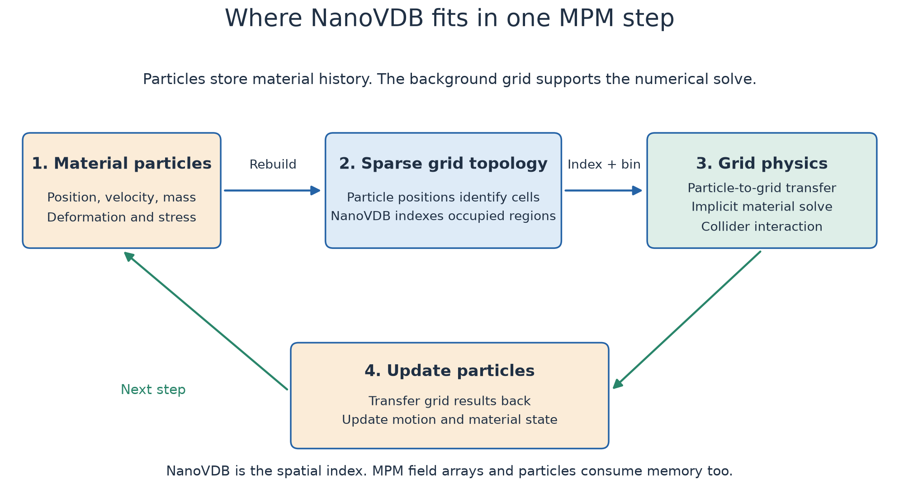
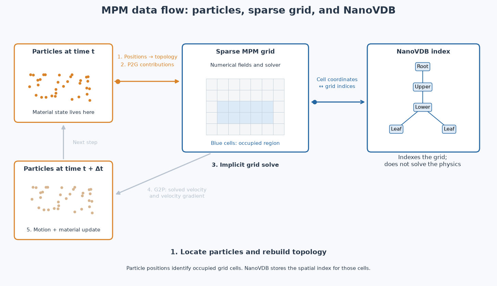
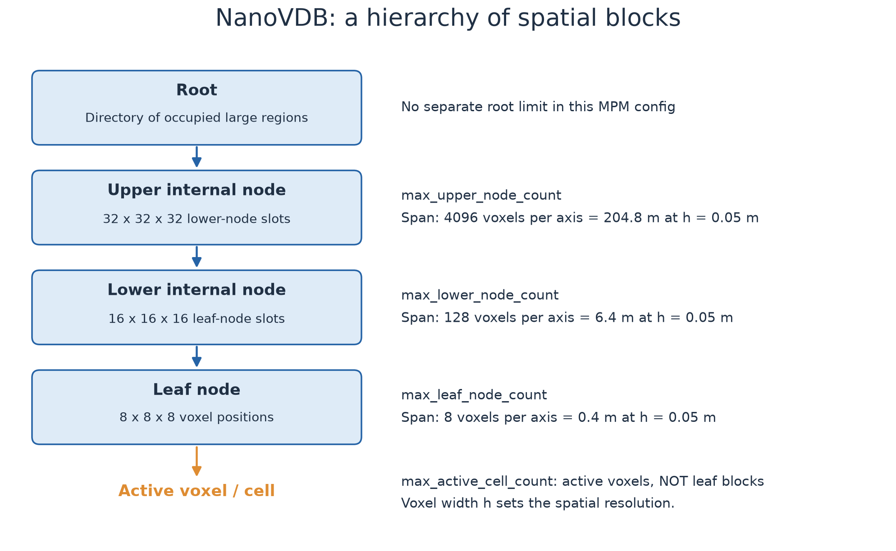
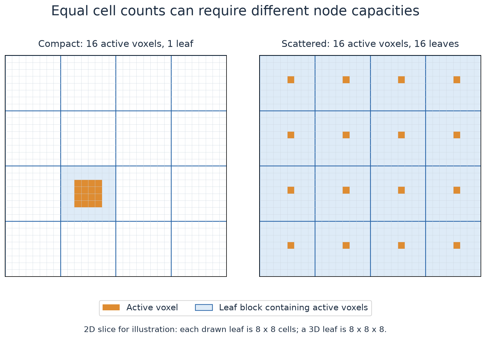
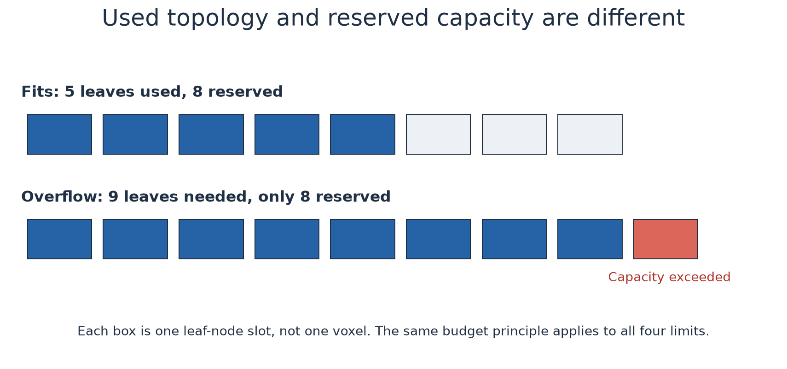
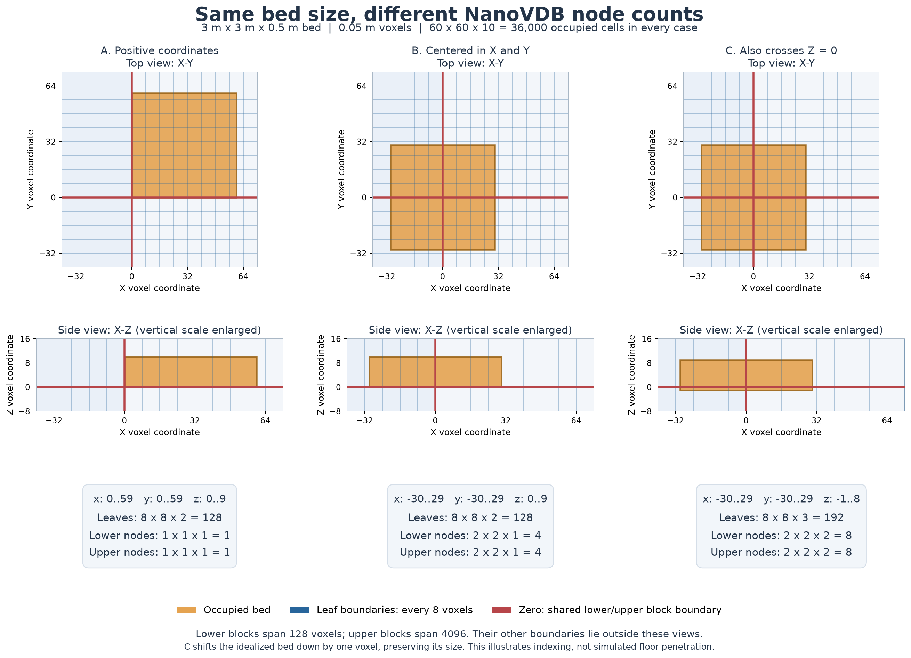

# Sparse MPM capacity sweep

This sweep tunes graph-compatible **rebuildable sparse** MPM, not per-step dynamic
allocation (`max_active_cell_count=-1`). It waits for other GPU compute processes
to exit before each isolated worker. Interactive examples and solver defaults
are not changed.

## What the parameters control

These parameters are **memory-capacity limits for the sparse simulation grid**.
They are not terrain dimensions, particle counts, or material parameters. To
understand them, first separate three things: material particles, the numerical
MPM grid, and NanoVDB's storage hierarchy.

### 1. Why an MPM simulation needs both particles and a grid

The sand particles carry position, velocity, mass, and material history such as
elastic deformation and plastic strain. The solver also needs a background grid
to compute the interactions that advance those particles.

A simplified step in this implicit MPM solver is:

1. Find the grid cells needed by the current active particle positions.
2. Assign particles to those cells and transfer their contributions to grid fields.
3. Solve the grid equations for motion and material response, including collider interaction.
4. Transfer the result back and update particle motion and material state.
5. Repeat using the new particle positions.



The diagram summarizes the data flow; it does not enumerate every implicit-solver
iteration. In the code, `SolverImplicitMPM.step()` calls `_particles_to_cells()`,
then `_rebuild_scratchpad()`, then `_step_impl()`. `_particles_to_cells()` rebuilds
the sparse geometry, creates a geometry partition, and bins particles with Warp
FEM's `PicQuadrature`.

A voxel is a small cube of grid space. If `voxel_size = 0.05`, its side length is
5 cm. Several particles can occupy one voxel. Increasing particles per cell adds
material samples without necessarily adding occupied grid cells. Conversely,
decreasing voxel size creates more cells for the same physical terrain.

| Term | Meaning here |
| --- | --- |
| Particle | A material sample carrying sand state |
| Grid cell / voxel | A small spatial cell used to organize and solve MPM |
| Grid field degree of freedom | A numerical unknown, such as a velocity component; its count depends on the field discretization |
| NanoVDB node | A storage block in a spatial tree; **not** a particle or an MPM grid vertex |

`max_active_cell_count` counts cells, not particles, and is not an exact count of
all velocity/strain unknowns in the solver.

### 2. What makes the grid sparse, and what NanoVDB does

#### Follow the data through one step



[Open the animated GIF](images/05_particle_grid_data_flow.gif) ·
[Open the static PNG](images/05_particle_grid_data_flow.png)

Read the animation in this order:

1. **Positions determine topology.** Locate active particles in grid cells and
   build/rebuild the NanoVDB index for the occupied regions.
2. **Particles → grid (P2G).** Accumulate particle mass, momentum, and material
   contributions into numerical grid fields.
3. **Solve on the grid.** Compute the response to gravity, material forces, and
   collider interaction.
4. **Grid → particles (G2P).** Interpolate the solved velocity and velocity
   gradients back to particle locations.
5. **Advance particles.** Update positions and material state; repeat at the next
   time step.

The blue **grid ↔ NanoVDB** connection means spatial lookup/indexing. It is not
another physics transfer like P2G or G2P. NanoVDB indexes the sparse geometry;
the numerical field arrays hold the quantities used by the MPM solve. There is
no separate “send sand state into NanoVDB, solve there, then return it” stage.

The particle movement and grid arrows are a **2D schematic**, not a recorded
simulation. In particular, the field discretization determines where grid
unknowns live; the drawn cell arrows are only an illustration of solved motion.


A dense representation reserves the cells throughout a bounding volume, including
empty space. A sparse representation keeps detailed topology for occupied
regions. For example, a shallow sand layer does not need a dense volume extending
far into the empty air above it.

Newton uses Warp's `Volume.allocate_by_voxels()` to build a NanoVDB volume from
particle positions. Warp FEM wraps that volume as a `Nanogrid`. NanoVDB provides
an efficient mapping from spatial coordinates to sparse grid locations. The
solver then uses that geometry to build and access its numerical field arrays.

**NanoVDB is a GPU-friendly sparse-volume data structure, not a sand model,
collision detector, or rendering-only structure.** The MPM solver supplies the
physics. A useful conceptual memory breakdown is:

```text
Total simulation memory
  = particle state
  + NanoVDB topology and indexing
  + MPM grid fields and solver workspaces
  + rigid-body/coupling state and other runtime allocations
```

The three `max_*_node_count` limits primarily budget the topology part.
`max_active_cell_count` also influences capacity-sized grid/solver buffers.
Reducing tree-node limits cannot remove the memory needed to store all particles.

NanoVDB uses the standard VDB hierarchy illustrated below. The branching layout
is documented in the [official NanoVDB header reference](https://www.openvdb.org/documentation/doxygen/NanoVDB_8h.html).

### 3. How the tree groups space



Read the tree from bottom to top:

- A **leaf node** covers an **8 × 8 × 8** block of voxel positions: 512 positions.
  Some can be inactive. One active voxel can still require a leaf block.
- A **lower internal node** groups **16 × 16 × 16 leaf slots**. Its spatial span
  is therefore `16 * 8 = 128` voxels along each axis.
- An **upper internal node** groups **32 × 32 × 32 lower-node slots**. Its span
  is `32 * 128 = 4096` voxels along each axis.
- The **root** identifies the large regions represented by upper nodes. Newton
  does not expose a separate `max_root_node_count` setting here.

A node's possible child slots are not all necessarily occupied. The hierarchy
lets the grid represent a region without allocating leaf detail everywhere
inside it. Internal-node tables and masks still take memory, which is why
reserving many unused internal nodes can be expensive too.

All levels refer to the **same finest-resolution grid**. This is not adaptive
MPM resolution: being in another leaf or upper node does not change voxel size.

At 5 cm voxel spacing:

| Storage level | Width in voxels | Physical width per axis |
| --- | ---: | ---: |
| Voxel | 1 | 0.05 m |
| Leaf | 8 | 0.4 m |
| Lower node | 128 | 6.4 m |
| Upper node | 4096 | 204.8 m |

A 204.8 m upper-node span does **not** mean 204.8 m of ground is being simulated.
It means one tree node can address smaller occupied regions within that span.

### 4. Why cell count alone cannot determine node count



In the left example, all 16 active voxels fit inside one leaf. In the right
example, each voxel lies in a different leaf, so 16 leaves are needed. Both have
16 active voxels, but their tree storage differs. The diagram is a 2D slice of
the 3D grouping scheme, not a benchmark result.

This explains the conservative default `max_leaf_node_count = -1`: Newton
reserves one leaf for every permitted active voxel. That covers the extreme
case of one voxel in each leaf. A compact sand bed generally uses far fewer
leaves, so a tighter application-specific budget can save memory.

Do **not** simply set leaf capacity to `ceil(active_cells / 512)`. That assumes
perfectly packed, aligned, full leaves. A thin bed, splash, or particles crossing
block boundaries can need more leaves for the same cell count.

### 5. Used counts versus reserved capacities



An **active count** describes what is used now. A **capacity** is the maximum
amount of storage reserved for future rebuilds. For instance, reserving 256
leaves does not make all 256 leaves physically active. If a later rebuild needs
257 leaves, the capacity is insufficient even if the active-cell budget still
has room.

With CUDA graphs, Newton uses a persistent sparse grid that can rebuild its
contents within preallocated storage. It must have room for the topology and
solver arrays needed by later steps. These capacities make that allocation
predictable; they do not freeze the occupied cells in world space.

| Config field | What the positive limit counts | Meaning of `-1` |
| --- | --- | --- |
| `max_active_cell_count` | Active grid voxels across all worlds; also bounds capacity-sized solver workspaces | Use per-step dynamic sparse allocation instead of the persistent bounded sparse path |
| `max_leaf_node_count` | Leaf blocks, each covering 8³ voxel positions | In bounded sparse mode, reserve one leaf per `max_active_cell_count` |
| `max_lower_node_count` | Lower internal nodes, each spanning 128³ voxel positions | Estimate from initial topology with 16× headroom, subject to minimum/caps below |
| `max_upper_node_count` | Upper internal nodes, each spanning 4096³ voxel positions | Estimate from initial topology with 16× headroom, subject to minimum/caps below |

The three node-capacity parameters are used only by **rebuildable sparse grids**.
Setting them does not tune the dynamic-allocation path selected by
`max_active_cell_count = -1`.

In `_rebuild_capacity()`, for a nonempty initial grid and the current caller's
`ratio = 16`, automatic capacities are resolved as follows:

```python
C = max_active_cell_count  # positive: rebuildable sparse mode
L = C if max_leaf_node_count == -1 else max_leaf_node_count
B_auto = min(C, max(8, ceil(16 * initial_lower_count)))
U_auto = min(C, max(4, ceil(16 * initial_upper_count)))
B = min(B_auto, L) if max_lower_node_count == -1 else max_lower_node_count
U = min(U_auto, B) if max_upper_node_count == -1 else max_upper_node_count
```

Empty initial grids have a separate fallback. The resolved values must satisfy
`U <= B <= L <= C`. This is a validation rule in this implementation, not a
formula saying how full every node must be.

If any budget is exceeded, the rebuild reports an overflow. After graph replay,
call `check_sparse_grid_rebuild_status()` to detect it. Do not interpret overflow
as a valid approximation that merely omits distant sand.

### 6. A concrete terrain example



[Open the full-size PNG](images/06_concrete_terrain_example.png).
The top row shows X-Y footprints; the second row shows X-Z sections with the
vertical scale enlarged. Blue lines mark leaf boundaries every eight voxels.
The red zero lines are also boundaries between lower and upper tree blocks;
their other boundaries are outside the plotted region.

Case C shifts the idealized bed down by one voxel (`z = -1..8`) so all three
cases retain exactly 36,000 occupied cells. Its leaf count rises to 192, and
its lower/upper counts rise to eight each. This is a coordinate-counting example,
not a claim that particles should penetrate the physical ground.


Consider a **3 m × 3 m × 0.5 m** bed at **0.05 m** voxel spacing. Ignoring sampling
jitter and boundary details, it occupies about:

```text
60 * 60 * 10 = 36,000 voxels
```

If those voxels have integer coordinates `x = 0..59`, `y = 0..59`, `z = 0..9`,
they occupy `8 * 8 * 2 = 128` leaves, one lower node, and one upper node.

Now center the bed horizontally about the world origin:

```text
x = -30..29, y = -30..29, z = 0..9
```

It still occupies 128 leaves, but now needs **four lower nodes and four upper
nodes**, because X and Y each cross a tree-block boundary at zero. Negative
coordinates use floor division: `floor(-1 / 128) = -1`, not zero.

If occupied cells also extend slightly below zero in Z, the tree needs blocks
on both sides of that boundary: this example can then need eight lower and
eight upper nodes. This is why a seemingly ample percentage above the initial
count can still overflow after settling.

These are idealized coordinate counts, **not fitted capacity recommendations**.
The real emitter's sampling and jitter, particle motion, and domain layout decide
the actual occupied cells. Inspect the live grid and budget for the intended
motion and spatial extent.

For the local Warp version, the distinction is available explicitly:

```python
# Diagnostic access to a private solver field: outside CUDA graph capture.
volume = mpm_solver._scratchpad.grid.cell_grid
used = volume.get_active_stats()
reserved = volume.get_rebuild_info()

print(used.voxel_count, used.leaf_node_count,
      used.lower_node_count, used.upper_node_count)
print(reserved.max_voxel_count, reserved.max_leaf_node_count,
      reserved.max_lower_node_count, reserved.max_upper_node_count)
```

Do not count the length of `get_voxels()` as current occupancy for a rebuildable
volume: its exported buffer can reflect reserved capacity. Warp documents the
separate [active statistics and rebuild capacity APIs](https://nvidia.github.io/warp/latest/api_reference/_generated/warp.Volume.html).
These diagnostic queries can synchronize the device, so keep them outside timed
physics steps as well as outside graph capture.

### 7. Where this happens in Newton

| Code location | Role |
| --- | --- |
| [`SolverImplicitMPM.Config`](../../../_src/solvers/implicit_mpm/solver_implicit_mpm.py) | Defines the four limits and voxel size |
| `_allocate_grid()` in the same file | Passes positions, masks, and capacities to sparse-grid construction |
| `_particles_to_cells()` in the same file | Rebuilds the persistent grid, partitions it, and bins particles |
| [`_rebuild_capacity()`](../../../_src/solvers/implicit_mpm/implicit_mpm_solver_kernels.py) | Computes the automatic leaf/lower/upper limits |
| `allocate_by_voxels()` in the same kernels file | Calls Warp's NanoVDB volume allocation with those limits |
| `build_active_particle_mask()` in the same kernels file | Includes finite-position particles whose `ACTIVE` flag is enabled |

The local Newton/Warp source is the authority for this checkout. The linked
online Warp API may describe a newer release.

Regenerate the PNGs without running a simulation or using the GPU:

```bash
uv run --no-sync newton/examples/mpm_moving_patch_alpha/sparse_capacity_sweep/illustrate_sparse_grid.py
```

## Sparse does not mean contact-only

`_particles_to_cells()` constructs/rebuilds the grid using particle positions.
`build_active_particle_mask()` includes finite-position particles carrying
`ParticleFlags.ACTIVE`. It does not test contact with the robot, speed, strain,
or whether a particle is visible. Untouched sand is still simulated.

With depth, voxel size, and particles per cell fixed, increasing a square bed's
side length increases particle and occupied-cell counts roughly with its area.
Node tuning can reduce reservation overhead and perhaps improve runtime, but
cannot make full-bed particle state and transfers constant-cost. Constant
operating-area cost requires a bounded active simulation region (e.g. the moving
patch), or a separate activation/deactivation algorithm.

## Experimental design

All cases use a moving dynamic box with two-way coupling, 0.05 m voxels, three
particle samples per voxel axis, 0.5 m bed depth, density 2500 kg/m³, particle
friction 0.75, 0.01 s frames, four MuJoCo substeps, and one proxy iteration.
The scene is normalized in a process-local subclass. Every tested grid is sparse
with positive capacity and outer CUDA graph capture. No rendering is timed.

Cell capacity is the next power of two above 1.5× nominal bed voxel count.
Initial occupied topology is measured by allocating an exact sparse volume;
node budgets are then configured before the solver is built. Profiles sweep
node multipliers relative to these initial occupied node counts:

| Profile | Leaf | Lower | Upper |
| --- | ---: | ---: | ---: |
| default | automatic | automatic | automatic |
| leaf2 | 2× | automatic | automatic |
| lower2 | 2× | 2× | automatic |
| upper2 | 2× | automatic | 2× |
| all2 | 2× | 2× | 2× |
| all125 | 1.25× | 1.25× | 1.25× |
| all4 | 4× | 4× | 4× |

Screening uses 60 warmup steps and 60 measured steps; these short runs identify
candidates, not long-horizon guaranteed safe limits. Raw JSON records every
step's synchronized wall time and GPU-event time, node limits, initial/final
occupied topology, particle count, scene validation, and overflow failures.
NVML memory is total-device memory minus the worker's pre-initialization
baseline, sampled at 20 Hz. Warp pool usage is recorded separately. Topology
inspection runs outside timed steps. CUDA/solver allocation pools remain enabled.

Run the screening sweep:

```bash
uv run --no-sync newton/examples/mpm_moving_patch_alpha/sparse_capacity_sweep/run_sweep.py --widths 3
```

Use a different `--tag` when changing warmup/steps/settings; existing result files
are retained and skipped. Cross-size followups use `--widths`, `--profiles`, and
`--repeats`; recommendations must be based on successful measurements and report
both the measurement horizon and capacity headroom. There is no universal
optimal capacity independent of particle distribution and future motion.

## Sweep status

The parameter search is paused at the user's request while another GPU batch
runs. Existing short-run results are provisional. The known contended case is
flagged and must not be used for recommendations. Early `screen/` JSON files
contain incorrect capacity-buffer-derived `topology_samples`; use the active
statistics recorded by the corrected harness instead. No optimal setting has
yet been established. The PNGs above are explanatory diagrams, not performance
results.

Regenerate the data-flow animation and its static companion using CPU-only plotting:

```bash
uv run --no-sync newton/examples/mpm_moving_patch_alpha/sparse_capacity_sweep/animate_mpm_data_flow.py
```

Regenerate the concrete-terrain illustration:

```bash
uv run --no-sync newton/examples/mpm_moving_patch_alpha/sparse_capacity_sweep/illustrate_terrain_example.py
```
