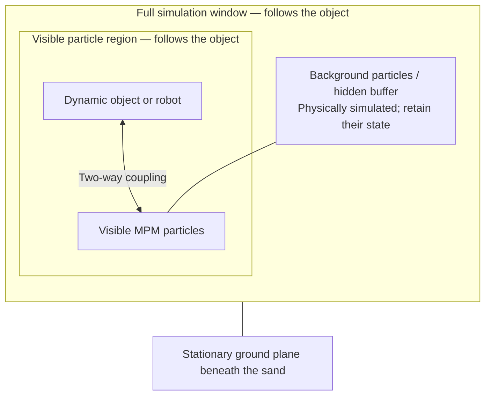
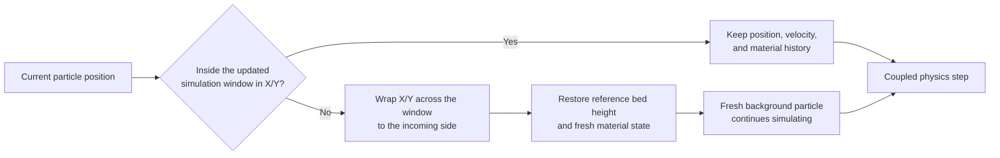
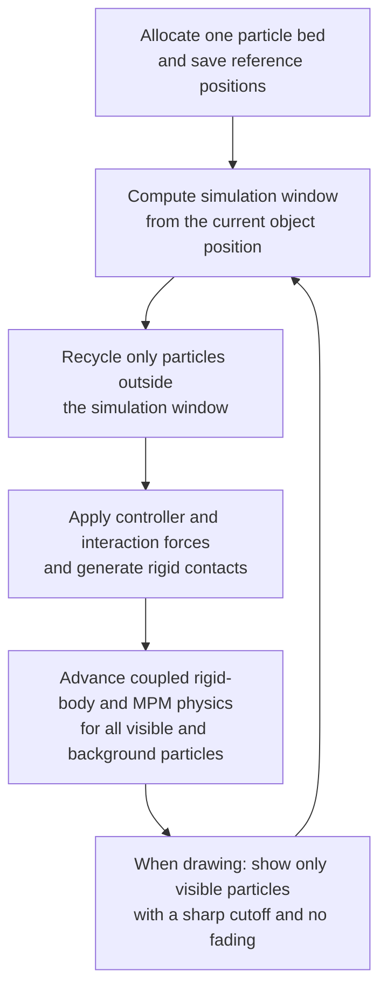

# Moving patch terrain

A moving patch keeps a bounded population of MPM particles around a moving object
or robot. The simulation window follows its horizontal position in discrete
increments. Particles remaining inside the window keep their world positions and
material history; the terrain is not translated with the object. Particles that
leave the window are recycled to represent fresh homogeneous terrain. This avoids
simulating an entire large environment, but discards terrain history outside the
window.

## Implementation diagrams

### Simulated particles and visible particles



Both visible and background particles are **active in the physics simulation**.
The visible boundary only controls drawing; it is not a wall or a reset boundary.
There is **no fade band**: particles are drawn at full size inside the visible
region and hidden outside it. The background buffer separates this rendering
cutoff from the outer recycling boundary. The visible region follows the object
continuously, while the simulation window moves in discrete increments.

### Particle recycling at the moving boundary



The check runs **before every coupled physics step**, using each particle's
current position. Only particles outside the full simulation window are reset.
A particle outside the visible region but still inside the simulation window is
not reset. Recycling also handles particles that escape while the window is
stationary. The test uses horizontal boundaries; it does not reset a particle
merely because its height changes.

Recycling wraps the current horizontal coordinates into the window and restores
the particle's original jittered reference height. It resets velocity, APIC
velocity gradient, and Cauchy stress to their resting values; elastic and
rendering deformation gradients return to identity, and the plastic determinant
returns to its default undeformed value. Particles inside the window preserve
all of these attributes. Recycled particles represent fresh terrain rather than
restoring previously disturbed terrain at that location.

### Per-step execution



The object remains dynamic and receives forces from the sand through two-way
coupling. The ground plane remains stationary. Rendering does not change physical
particle radii, mass, or material state, and does not freeze background particles.
The particle allocation is reused across window shifts.

The hidden buffer normally keeps recycling away from the visible interaction
region, but abrupt motion can expose freshly reset particles. This implementation
assumes homogeneous terrain and does not preserve tracks outside the window.
Long-distance stability and force continuity require further validation.

## References

- [Project Chrono terrain API](https://api.projectchrono.org/classchrono_1_1vehicle_1_1_c_r_m_terrain.html#a4ec79e27bc851e731626d826fd11e629)
- [ChronoCRM terrain simulation](https://sbel.wisc.edu/2025/10/04/sbel-researchers-develop-chronocrm-simulator-for-fast-and-scalable-rover-terrain-interaction/)

## Validation

```bash
uv run --extra dev -m newton.tests.test_mpm_moving_patch
uv run --extra dev -m newton.examples mujoco_mpm_coupled_solver_moving_patch --viewer null --num-frames 300 --test
```


### Policy-driven ANYmal variant

Run the same moving patch with the ANYmal robot and policy from `example_mpm_anymal.py`:

```bash
uv run --extra examples --extra onnx -m newton.examples mujoco_mpm_coupled_solver_moving_patch_anymal
```

The new example subclasses the box moving-patch scene. Its terrain allocation,
particle jitter, recycling, rendering buffer, and two-way proxy coupling are
unchanged. All 13 robot bodies and 13 joints belong to the MuJoCo entry; the MPM
entry receives dynamic body proxies and returns contact forces to MuJoCo. As in
the original ANYmal example, only the shanks collide with MPM particles.
The robot's base (body 0) controls the patch center.

The 48-observation, 12-action ONNX policy runs at 50 Hz and produces position
targets with the original action scale and PD gains. Coupled physics runs at
100 Hz with four MuJoCo substeps per frame by default. The robot initially faces
world +Y and starts above the 0.5 m sand bed.

It walks forward automatically. I/K command forward/backward motion, J/L command
sideways motion, and U/O turn. Pressing a movement key disables automatic forward
motion; releasing the keys commands zero velocity. The sidebar can re-enable
automatic walking. Right-click dragging and buffer/impulse visualization remain
available. The patch follows the robot; the viewing camera remains fixed.

**Limitation:** this is a coupling experiment, not a validated sand locomotion
controller. The pretrained policy can sink and stall in the deep terrain, even
though joint actuation and feedback remain active. Unlike the original MPM ANYmal
example's kinematic sand colliders, this version lets sand forces affect the robot.

Validation includes headless runs with and without CUDA graphs, an offscreen
render, and checks for nonzero policy actions, sand feedback, and patch shifts.
A longer 500-frame run triggered the inherited ground-height assertion for one
of the 1,142,784 particles; long-duration particle containment remains an open
limitation of this prototype.
